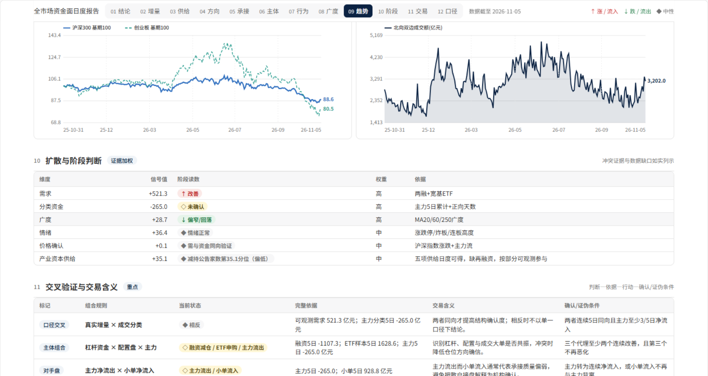

**VicAlpha** 把市场研究、持仓分析和策略回测放在同一个工作空间。你可以从一个问题开始，查看支持判断的数据，再把值得持续观察的变化设为跟踪任务。

**[进入 VicAlpha ↗](https://vicalpha.com/)**　 ·　 [浏览研究广场](https://vicalpha.com/plaza)　 ·　 [投研台](#投研台)　 ·　 [内置策略](#内置策略)

## 从问题开始

行业上涨，有多少成分股跟上？从广场挑一份市场复盘，或在工作空间直接提问。会话与研究成果保存在一起，下次可以回到原来的假设继续查证。

查看研究广场与工作空间

**从广场发现研究主题**

**在工作空间展开研究**

## 投研台

截至 2026 年 11 月 5 日，官网发现目录共 19 个投研台。点击名称直接进入对应投研台，部分入口需要登录。下表按研究用途整理，列出页面内的导航或报告章节。

### 市场与策略

| 投研台 | 研究问题 | 台内导航与专题 |
| --- | --- | --- |
| [A 股行情综合屏](https://vicalpha.com/dashboard/trk_01M544AT6G7NJDN1DGTHD3TZWJ) | 市场涨跌由哪些板块带动？ | 行情、情绪、板块、资金、龙虎榜 |
| [情绪温度计](https://vicalpha.com/dashboard/trk_01M6GATFGCSW9T3W052JCYZP3D) | 市场情绪处于什么位置？ | 温度总览、维度分解、指标明细、信号事件、历史复盘 |
| [涨停板](https://vicalpha.com/dashboard/trk_01M652CD3DX0AXP42X0KFD3ZYT) | 连板高度和题材热度如何演变？ | 情绪总览、连板天梯、题材主线、个股明细、次日表现 |
| [XHN-A股择时系统](https://vicalpha.com/live/trk_01M0Z1BYTTESV4KJRNQFY17243) | 左侧、同步与右侧信号何时一致？ | 综合看板、左侧抄底、同步跟踪、右侧逃顶、使用方法、指标体系 |
| [逆向投资](https://vicalpha.com/dashboard/trk_01M67TX7K5KDJ9TM5ZESM0CR7V) | 哪些低温行业出现拐点信号？ | 逆向总览、市场温度、行业逆向、候选榜、陷阱排雷、拐点信号 |
| [A 股产业链图谱](https://vicalpha.com/dashboard/trk_01M1R26Z79TDB92XS5M3ZA7AMJ) | 同一条产业链的上下游有哪些环节？ | 选择产业链、上中下游图谱。页面提供环节与产品的下钻说明 |

### 资金与交易结构

| 投研台 | 研究问题 | 台内导航与专题 |
| --- | --- | --- |
| [A股资金流投研台](https://vicalpha.com/live/trk_01M0KE8SD5E4FC9TYVX82JSR05) | 如何从资金需求、供给与广度形成日度判断？ | 日度报告共 12 节：结论、增量、供给、方向、承接、主体、行为、广度、趋势、阶段、交易、口径 |
| [A 股资金流](https://vicalpha.com/dashboard/trk_01M5MH0K50GYYV6EMYT674E7KP) | 哪些渠道和板块的资金动向值得跟踪？ | 总览、主力动向、板块跟踪、个股热图、两融杠杆、跨境资金、ETF 资金、龙虎榜、产业资本 |
| [A 股融资融券](https://vicalpha.com/dashboard/trk_01M61AJ1TDEH04E6QTJ82DAVJQ) | 杠杆周期走到哪里？哪些标的风险较高？ | 总览、杠杆周期、行业两融、个股两融、风险监测、个股详情 |
| [全 A 筹码结构](https://vicalpha.com/dashboard/trk_01M68EM7X3XGD7ZSFKGWQ0YMHR) | 不同板块的持仓成本和获利比例有何差异？ | 筹码总览、行业筹码、筹码筛选、个股筹码 |
| [A 股交易拥挤度](https://vicalpha.com/dashboard/trk_01M5NRYV1THPTBNSA5QZTZXCQC) | 拥挤集中在哪些行业、风格和个股？ | 总览、市场拥挤、行业拥挤、行业详情、风格拥挤、个股拥挤、个股详情、机构持仓 |
| [股票供给](https://vicalpha.com/dashboard/trk_01M6K5FQ4ZM6J04MDHVCFX88Z8) | 如何跟踪发行、减持、回购与解禁压力？ | 官网已列出；打开后提示「该台暂未接入」 |
| [股票ETF资金流](https://vicalpha.com/dashboard/trk_01M6J2TE6YHG3N1M1PTQYYR80Q) | 如何观察 ETF 净申购与成分股被动需求？ | 官网已列出；打开后提示「该台暂未接入」 |

### 机构与持仓

| 投研台 | 研究问题 | 台内导航与专题 |
| --- | --- | --- |
| [公募抱团](https://vicalpha.com/dashboard/trk_01M61AH34C7CZVPRZABP2H6FNV) | 公募持仓集中在哪里？拥挤组的表现如何？ | 抱团总览、个股拥挤度、个股透视、基金与资金、行业与仓位、抱团指数 |
| [A 股公募持仓](https://vicalpha.com/dashboard/trk_01M6BNGVY94CDVMMTZFJX6VPV6) | 不同基金公司怎样配置行业和个股？ | 持仓总览、公募排行、持仓详情、个股持仓、行业动向、持仓热力、公司比较 |
| [美股 13F 机构持仓](https://vicalpha.com/dashboard/trk_01M1WKA7BJYSXWN5T2XN6EED58) | 哪些机构调整了持仓？行业分布如何变化？ | 13F 总览、机构排行、机构详情、个股持仓、行业动向、持仓动向、机构对比 |
| [国家队全景](https://vicalpha.com/dashboard/trk_01M6FBPM1THJ7KECTFKEQB8DMB) | 国家队通过哪些 ETF 和持股组合参与市场？ | 全景总览、ETF 托底、持股组合、持仓全景、调仓动向、主体详情、个股透视 |
| [A 股十大流通股东](https://vicalpha.com/dashboard/trk_01M55196PFQ2GNCF02D9YJMPMM) | 重要股东持有哪些标的？筹码是否更集中？ | 股东总览、主体排行、主体详情、个股股东、行业动向、筹码集中度、事件信号 |
| [机构调研](https://vicalpha.com/dashboard/trk_01M6MGXHV4JVMCNXJPVQ0K27FG) | 哪些公司受到机构调研关注？ | 官网已列出；打开后提示「该台暂未接入」 |

**投研台实景选览**

展开其余五张投研台实景

**美股 13F · 季度持仓**

**三阶段择时 · 综合得分**

**A 股资金流 · 市场总览**

**A 股资金流 · 行业方向**

**A 股资金流 · 趋势与阶段**

## 内置策略

研究想法能否写成可重复检验的规则？选股回答“选哪些标的”，择时回答“何时参与”。以下八项来自官网官方策略库，可打开报告查看历史回测。

| 类型 | 策略 | 规则 |
| --- | --- | --- |
| 选股 · 价值 | 低 PB | 按账面价值相对市值筛选股票。 |
| 选股 · 质量 | Piotroski F-Score | 用九项财务信号衡量公司质量。 |
| 选股 · 价值 | 聂夫总回报 | 结合低市盈率、适度增长和分红筛选公司。 |
| 选股 · 资金流 | 基金持仓增持 | 关注公募持仓占比连续两个报告期上升的公司。 |
| 择时 · 复合 | 赫尔均线趋势 | 观察赫尔均线相对前值的升降。 |
| 择时 · 趋势跟踪 | 指数均线金叉 | 以短期与长期指数移动平均线的交叉跟踪趋势。 |
| 择时 · 趋势跟踪 | 半趋势通道翻转 | 用高低价格的平滑通道识别多空转换。 |
| 择时 · 趋势跟踪 | SuperTrend 趋势线 | 观察价格穿越基于 ATR 的轨道时，趋势方向是否翻转。 |

查看选股、择时与回测报告

**官方选股策略**

**官方择时策略**

**回测报告 · 样本分布**

## 持续跟踪

把关注的标的放进自选，沿同一交易日对照价格、均线与成交量。需要观察变化时，可以在信号页按类别、方向和强度筛选，再到任务页查看定时研究与回测任务的执行状态。

查看自选行情、信号与任务

**自选行情 · K 线与成交量**

**信号 · 类别与强度筛选**

**任务 · 类型、频率与状态**

[打开 VicAlpha，开始研究 ↗](https://vicalpha.com/)
