[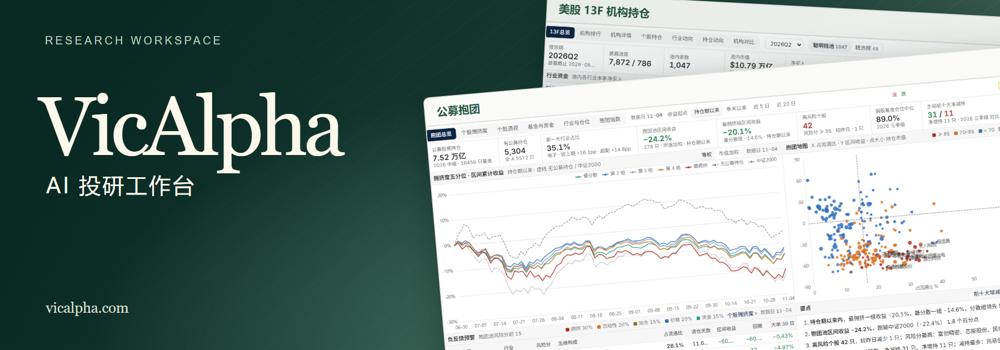](https://vicalpha.com/)

## 为机构级投资研究而设计的 AI 原生投研系统

在 VicAlpha，你可以用自然语言分析公司与市场、开发并回测策略、构建专属投研台，也可以直接描述需要关注的信号。平台实时跟踪你设定的条件，在信号触发时提醒你。

多市场数据库与底层知识库共同构成 VicAlpha 的研究基础。数据库覆盖 A 股、港股和美股，以及 ETF、基金等投资品种，为跨市场分析、持仓研究和策略回测提供数据；知识库为 AI 分析提供研究背景，帮助研究者结合上下文解读数据。

例如，研究行业轮动时，可以先问「近期哪些行业的资金流入在加速？」，再要求把观察指标整理成投研台，开发并回测一套轮动策略，最后设置信号：「当行业满足这套策略的入选条件时提醒我。」

**使用 [VicAlpha](https://vicalpha.com/) 开启专业投研与交易工作流。**

## 产品能力结构

多市场数据库与知识库提供研究资料，Sandbox（沙箱）提供研究执行环境。上层工作空间将这些基础能力与投研 Skills、策略回测和持续跟踪工具结合。

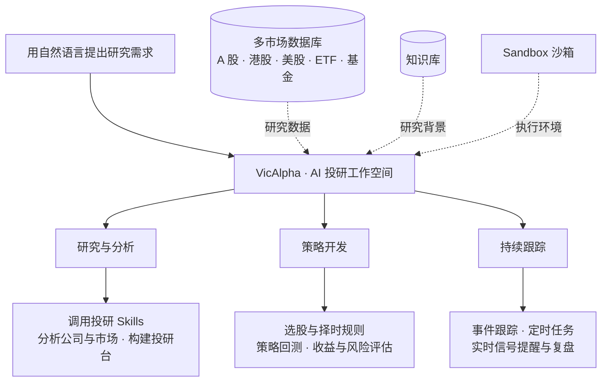

## 从问题开始

行业上涨，有多少成分股跟上？从广场挑一份市场复盘，或在工作空间直接提问。会话与研究成果保存在一起，下次可以回到原来的假设继续查证。

查看研究广场与工作空间

**从广场发现研究主题**

[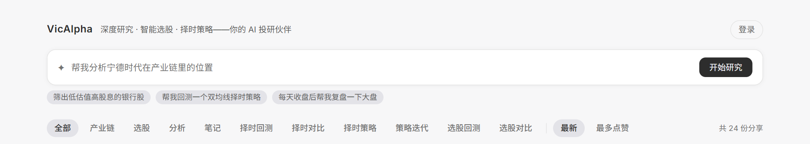](images/research-plaza.png)

**在工作空间展开研究**

[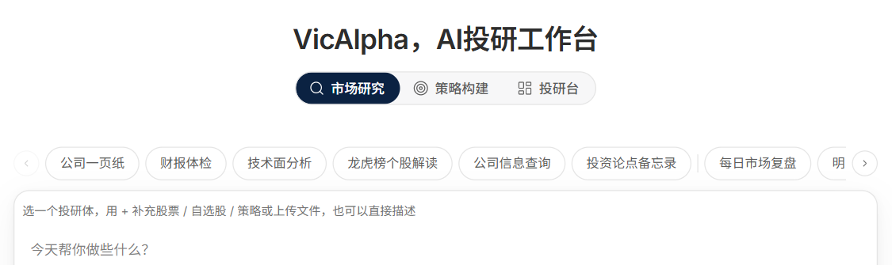](images/workspace.png)

### 用 Skills 开始研究

官网 Skills 库有 15 个官方模板，分为个股分析、市场研究、资金流向和投研台四类。选「财报体检」核对管理层承诺与异常信号，或用「投资论点备忘录」论证并反证一个假设。点击模板即可开始对话。 [浏览 Skills ↗](https://vicalpha.com/skills)

<a href="images/skills-library.png">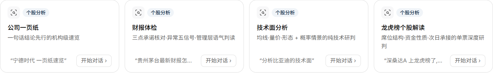</a>

---

## 投研台

你可以用自然语言构建自己的机构级投研台。描述你想研究的问题、需要对照的指标和希望跟踪的信号，例如「帮我搭建一个行业轮动投研台，把市场广度、行业资金流和择时信号放在一起」。

你也可以直接使用[研究广场](https://vicalpha.com/plaza)里的现成投研台。下表按研究用途整理了官网发现目录中的 19 个投研台（2026 年 11 月 5 日），点击名称即可进入，部分入口需要登录。

### 市场与策略

| 投研台 | 研究问题 | 台内导航与专题 |
| --- | --- | --- |
| [A 股行情综合屏](https://vicalpha.com/dashboard/trk_01M544AT6G7NJDN1DGTHD3TZWJ) | 市场涨跌由哪些板块带动？ | 行情、情绪、板块、资金、龙虎榜 |
| [情绪温度计](https://vicalpha.com/dashboard/trk_01M6GATFGCSW9T3W052JCYZP3D) | 市场情绪处于什么位置？ | 温度总览、维度分解、指标明细、信号事件、历史复盘 |
| [涨停板](https://vicalpha.com/dashboard/trk_01M652CD3DX0AXP42X0KFD3ZYT) | 连板高度和题材热度如何演变？ | 情绪总览、连板天梯、题材主线、个股明细、次日表现 |
| [XHN-A股择时系统](https://vicalpha.com/live/trk_01M0Z1BYTTESV4KJRNQFY17243) | 左侧、同步与右侧信号何时一致？ | 综合看板、左侧抄底、同步跟踪、右侧逃顶、使用方法、指标体系 |
| [逆向投资](https://vicalpha.com/dashboard/trk_01M67TX7K5KDJ9TM5ZESM0CR7V) | 哪些低温行业出现拐点信号？ | 逆向总览、市场温度、行业逆向、候选榜、陷阱排雷、拐点信号 |
| [A 股产业链图谱](https://vicalpha.com/dashboard/trk_01M1R26Z79TDB92XS5M3ZA7AMJ) | 同一条产业链的上下游有哪些环节？ | 选择产业链、上中下游图谱。页面提供环节与产品的下钻说明 |

<table><tr><td width="50%" valign="top"><a href="images/market-temperature.png">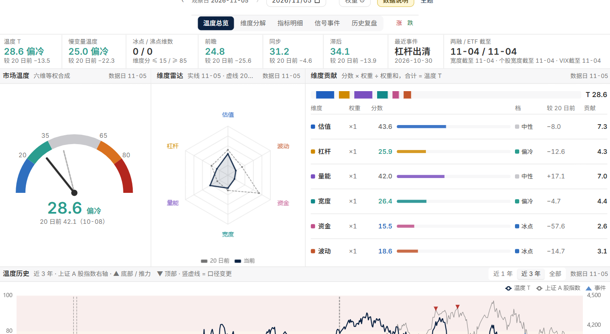</a> 情绪温度计 · 六维贡献</td><td width="50%" valign="top"><a href="images/timing-desk.png">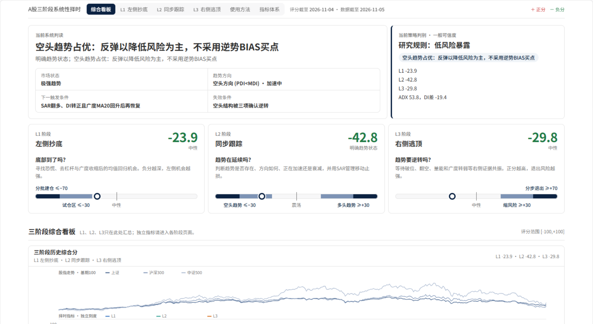</a> 三阶段择时 · 综合评分</td></tr></table>

### 资金与交易结构

| 投研台 | 研究问题 | 台内导航与专题 |
| --- | --- | --- |
| [A股资金流投研台](https://vicalpha.com/live/trk_01M0KE8SD5E4FC9TYVX82JSR05) | 如何从资金需求、供给与广度形成日度判断？ | 日度报告共 12 节：结论、增量、供给、方向、承接、主体、行为、广度、趋势、阶段、交易、口径 |
| [A 股资金流](https://vicalpha.com/dashboard/trk_01M5MH0K50GYYV6EMYT674E7KP) | 哪些渠道和板块的资金动向值得跟踪？ | 总览、主力动向、板块跟踪、个股热图、两融杠杆、跨境资金、ETF 资金、龙虎榜、产业资本 |
| [A 股融资融券](https://vicalpha.com/dashboard/trk_01M61AJ1TDEH04E6QTJ82DAVJQ) | 杠杆周期走到哪里？哪些标的风险较高？ | 总览、杠杆周期、行业两融、个股两融、风险监测、个股详情 |
| [全 A 筹码结构](https://vicalpha.com/dashboard/trk_01M68EM7X3XGD7ZSFKGWQ0YMHR) | 不同板块的持仓成本和获利比例有何差异？ | 筹码总览、行业筹码、筹码筛选、个股筹码 |
| [A 股交易拥挤度](https://vicalpha.com/dashboard/trk_01M5NRYV1THPTBNSA5QZTZXCQC) | 拥挤集中在哪些行业、风格和个股？ | 总览、市场拥挤、行业拥挤、行业详情、风格拥挤、个股拥挤、个股详情、机构持仓 |
| [股票供给](https://vicalpha.com/dashboard/trk_01M6K5FQ4ZM6J04MDHVCFX88Z8) | 如何跟踪发行、减持、回购与解禁压力？ | 官网已列出；打开后提示「该台暂未接入」 |
| [股票ETF资金流](https://vicalpha.com/dashboard/trk_01M6J2TE6YHG3N1M1PTQYYR80Q) | 如何观察 ETF 净申购与成分股被动需求？ | 官网已列出；打开后提示「该台暂未接入」 |

<table><tr><td width="50%" valign="top"><a href="images/market-monitor.png">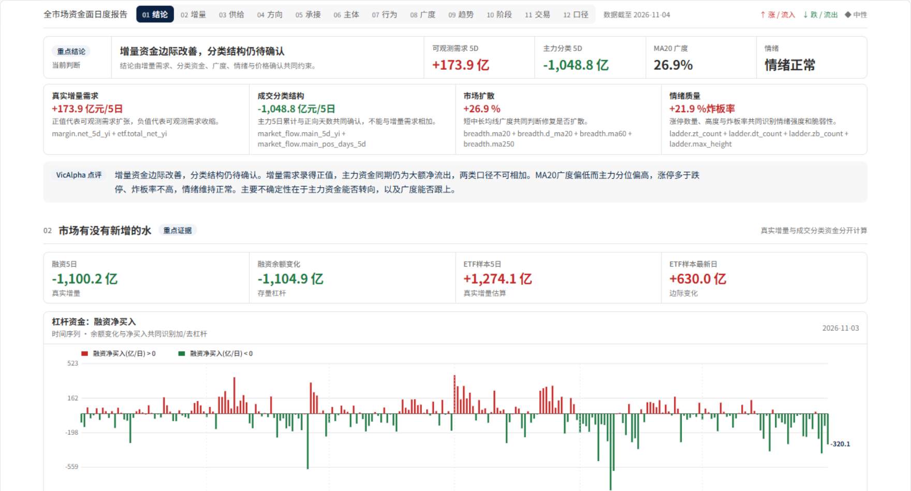</a> 资金流 · 市场总览</td><td width="50%" valign="top"><a href="images/flow-direction.png">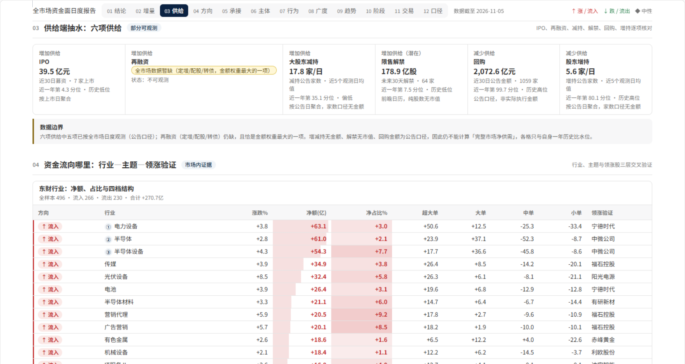</a> 资金流 · 行业方向</td></tr></table>

[查看更多资金流趋势与阶段](images/flow-breadth.png)

### 机构与持仓

| 投研台 | 研究问题 | 台内导航与专题 |
| --- | --- | --- |
| [公募抱团](https://vicalpha.com/dashboard/trk_01M61AH34C7CZVPRZABP2H6FNV) | 公募持仓集中在哪里？拥挤组的表现如何？ | 抱团总览、个股拥挤度、个股透视、基金与资金、行业与仓位、抱团指数 |
| [A 股公募持仓](https://vicalpha.com/dashboard/trk_01M6BNGVY94CDVMMTZFJX6VPV6) | 不同基金公司怎样配置行业和个股？ | 持仓总览、公募排行、持仓详情、个股持仓、行业动向、持仓热力、公司比较 |
| [美股 13F 机构持仓](https://vicalpha.com/dashboard/trk_01M1WKA7BJYSXWN5T2XN6EED58) | 哪些机构调整了持仓？行业分布如何变化？ | 13F 总览、机构排行、机构详情、个股持仓、行业动向、持仓动向、机构对比 |
| [国家队全景](https://vicalpha.com/dashboard/trk_01M6FBPM1THJ7KECTFKEQB8DMB) | 国家队通过哪些 ETF 和持股组合参与市场？ | 全景总览、ETF 托底、持股组合、持仓全景、调仓动向、主体详情、个股透视 |
| [A 股十大流通股东](https://vicalpha.com/dashboard/trk_01M55196PFQ2GNCF02D9YJMPMM) | 重要股东持有哪些标的？筹码是否更集中？ | 股东总览、主体排行、主体详情、个股股东、行业动向、筹码集中度、事件信号 |
| [机构调研](https://vicalpha.com/dashboard/trk_01M6MGXHV4JVMCNXJPVQ0K27FG) | 哪些公司受到机构调研关注？ | 官网已列出；打开后提示「该台暂未接入」 |

<table><tr><td width="50%" valign="top"><a href="images/fund-holdings.png">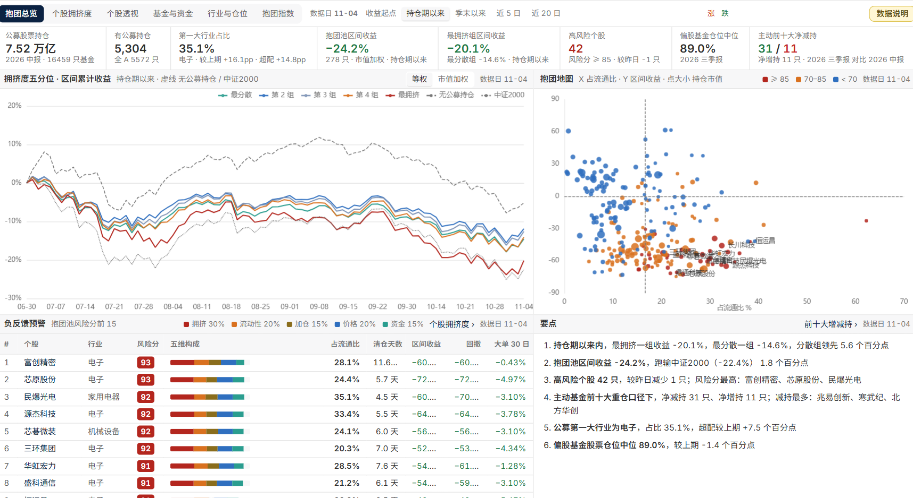</a> 公募抱团 · 拥挤度与收益</td><td width="50%" valign="top"><a href="images/us-holdings.png">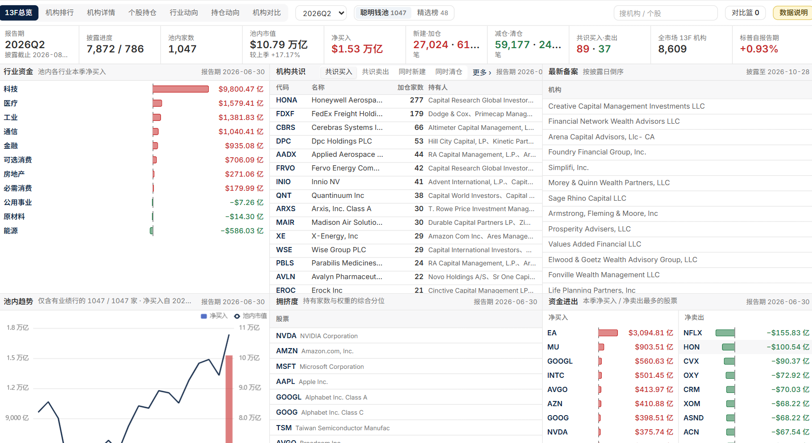</a> 美股 13F · 机构持仓</td></tr></table>

**[开始构建自己的第一个投研台](https://vicalpha.com/tracker)**

---

## AI 策略回测

在「策略构建 → 策略回测」用自然语言说明策略、基准和想比较的指标。下图是双均线需求的输入示例；右图取自已有的官方赫尔均线报告，展示另外一套规则的参数、买卖条件、失效场景、最大回撤及夏普。

<table><tr><td width="50%" valign="top"><a href="images/ai-backtest.png">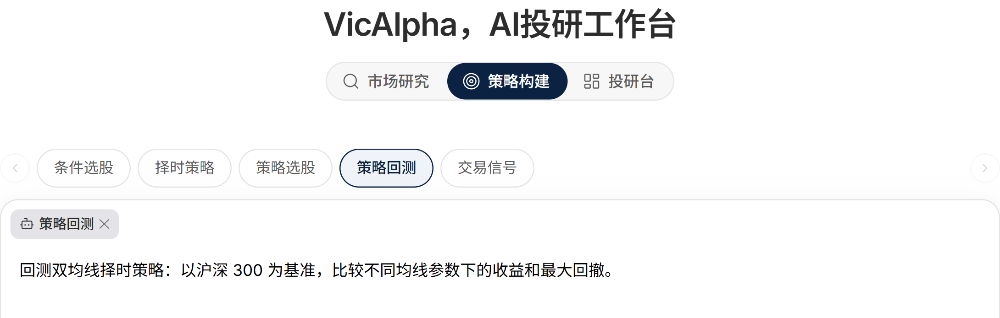</a> 策略回测 · 自然语言需求示例</td><td width="50%" valign="top"><a href="images/strategy-report.png">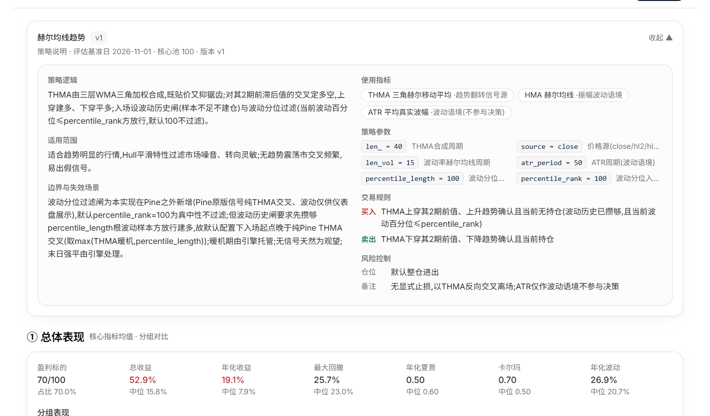</a> 官方报告 · 赫尔均线趋势</td></tr></table>

## 内置策略

研究想法能否写成可重复检验的规则？选股回答“选哪些标的”，择时回答“何时参与”。以下八项来自官网官方策略库，可打开报告查看历史回测。

| 类型 | 策略 | 规则 |
| --- | --- | --- |
| 选股 · 价值 | 低 PB | 按账面价值相对市值筛选股票。 |
| 选股 · 质量 | Piotroski F-Score | 用九项财务信号衡量公司质量。 |
| 选股 · 价值 | 聂夫总回报 | 结合低市盈率、适度增长和分红筛选公司。 |
| 选股 · 资金流 | 基金持仓增持 | 关注公募持仓占比连续两个报告期上升的公司。 |
| 择时 · 复合 | 赫尔均线趋势 | 观察赫尔均线相对前值的升降。 |
| 择时 · 趋势跟踪 | 指数均线金叉 | 以短期与长期指数移动平均线的交叉跟踪趋势。 |
| 择时 · 趋势跟踪 | 半趋势通道翻转 | 用高低价格的平滑通道识别多空转换。 |
| 择时 · 趋势跟踪 | SuperTrend 趋势线 | 观察价格穿越基于 ATR 的轨道时，趋势方向是否翻转。 |

查看选股、择时与回测报告

**官方选股策略**

[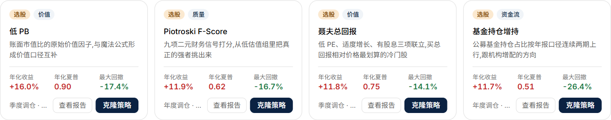](images/selection.png)

**官方择时策略**

[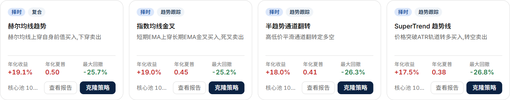](images/timing.png)

**回测报告 · 样本分布**

[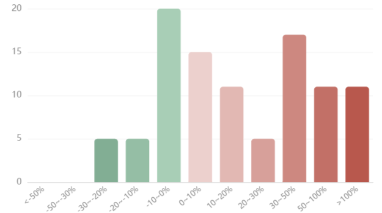](images/backtest.png)

## 持续跟踪

把关注的标的放进自选，沿同一交易日对照价格、均线与成交量。需要观察变化时，可以在信号页按类别、方向和强度筛选，再到任务页查看定时研究与回测任务的执行状态。

查看自选行情、信号与任务

**自选行情 · K 线与成交量**

[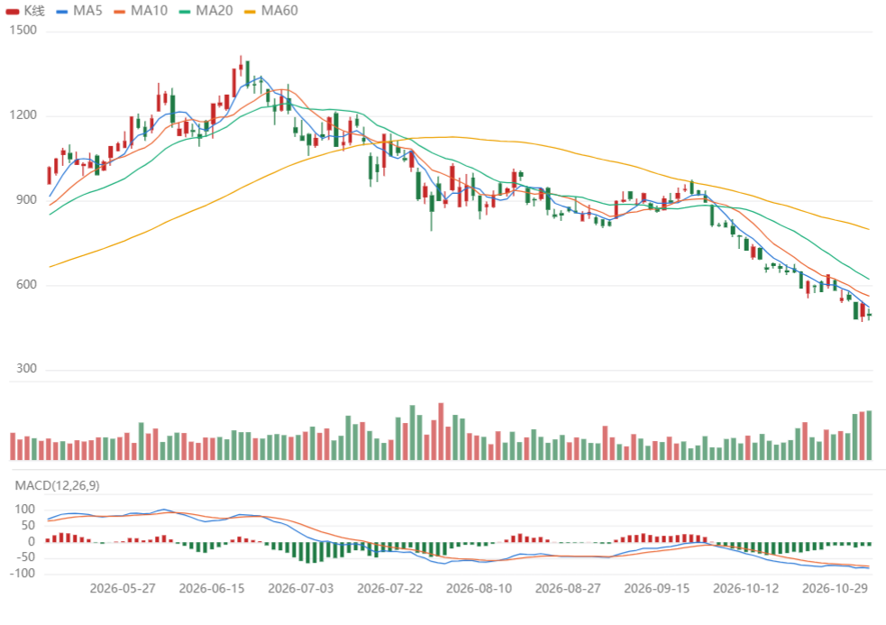](images/watchlist.png)

**信号 · 类别与强度筛选**

**任务 · 类型、频率与状态**

[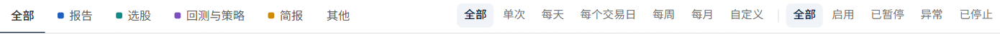](images/jobs.png)

### 设置定时任务

从任务页选择「新建任务」，用自然语言说明研究内容和频率，例如每个交易日收盘后复盘市场广度。回到任务页，可按单次、每天、每个交易日、每周、每月或自定义频率筛选，并检查启用、暂停或异常状态。 [打开任务页 ↗](https://vicalpha.com/jobs)

<table><tr><td width="50%" valign="top"><a href="images/scheduled-prompt.png">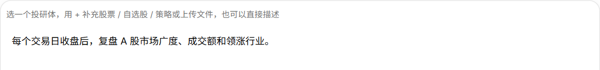</a> 新建任务 · 指令示例</td><td width="50%" valign="top"> 任务列表 · 周期与状态筛选</td></tr></table>

[打开 VicAlpha，开始研究 ↗](https://vicalpha.com/)
