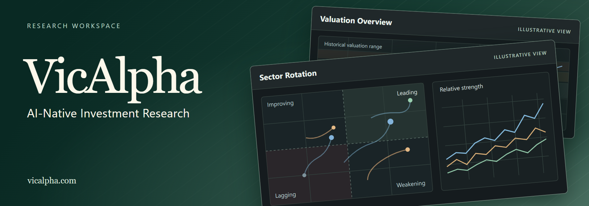
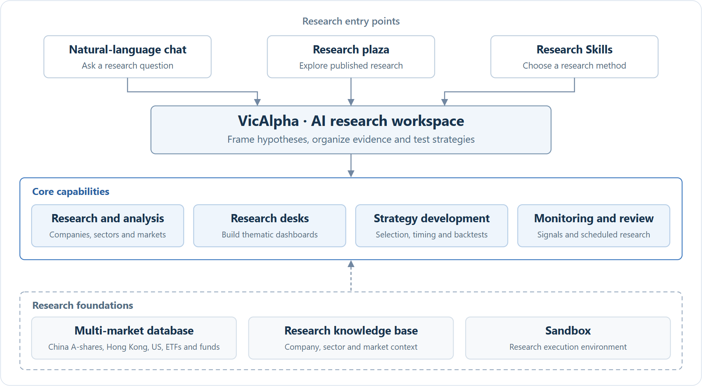

<h1 align="center">VicAlpha · AI-Native Investment Research</h1>

<b>A research workspace designed for institutional investment workflows</b>

**Research markets, develop strategies and build research desks in natural language.** Describe a signal and VicAlpha tracks the condition in real time, alerting you when it fires.

The **multi-market database** covers US, Hong Kong and mainland China equities, ETFs and funds. A **research knowledge base** provides context for company analysis, holdings research and backtests.

> **Sector rotation**　“Which industries are seeing accelerating inflows? Put them on a desk, backtest a rotation strategy, and alert me when an industry qualifies.”

**Start your investment research workflow with [VicAlpha](https://vicalpha.com/).**

<strong><a href="#capabilities">✨ Capabilities</a> · <a href="#architecture">🏛️ Architecture</a> · <a href="#desks">📊 Research desks</a> · <a href="#strategies">🧪 Strategies</a> · <a href="#signals">📡 Signals</a></strong>

<a href="README.zh-CN.md">简体中文</a> | English | <a href="README.zh-TW.md">繁體中文</a>

## ✨ Core capabilities

| 🔎 Research | 📊 Strategy development | 📡 Monitoring |
| --- | --- | --- |
| **15 research Skills** · Company, financial, market and flow analysis | **Natural-language strategies** · Define selection and timing rules and backtest them | **Live signals** · Filter by direction, strength and event |
| **22 desk entries** · Build or explore thematic workspaces | **Public strategies** · Inspect rules, NAV, drawdowns and groups | **Scheduled research** · Run on trading days or a custom schedule |

## 🏛️ Platform structure

Market data and the knowledge base supply research inputs. **Sandbox** provides a research execution environment. The workspace brings these together for analysis, desk construction, strategy development and monitoring.

[View Mermaid source](images/platform-structure-en.mmd)

## 💬 Research workspace and plaza

Ask a question and follow the evidence in the same conversation. For example, “Did a few large semiconductor stocks drive today’s advance, or did most constituents participate?”

Browse market reviews, industry-chain reports and strategy research in the plaza. In your workspace, each research artifact retains a path to its source conversation.

[**Start your first research session ↗**](https://vicalpha.com/)

| Entry | Use |
| --- | --- |
| Research plaza | Discover published research by artifact type. |
| Workspace | Develop a hypothesis and revisit the discussion behind a result. |

The plaza separates official boards from community reports and strategies. Browse by category or search, then return to the workspace to ask a follow-up question.

<table><tr><td width="50%" valign="top"> Official boards in the research plaza</td><td width="50%" valign="top"> Natural-language research workspace</td></tr></table>

## 🧩 Research Skills

Choose from **15 official templates**, then specify the security, reporting period and hypothesis. Try “Review this company’s financial statements and check whether management delivered on its prior commitments.”

[**Choose a research Skill ↗**](https://vicalpha.com/skills)

| Category | Templates | Examples |
| --- | --- | --- |
| Company analysis | 6 | Company briefs, financial reviews, technical analysis and investment theses. |
| Market research | 4 | Closing reviews, market regimes and themes for the next session. |
| Capital flows | 3 | Flows, state-backed investors and exchange trading disclosures. |
| Research desks | 2 | Ongoing investigation of a theme. |

Alongside the 15 official templates, you can import your own Skill from a ZIP, Markdown or text file up to 1 MB, or paste the research method directly.

<table><tr><td width="50%" valign="top"> Official Skills library</td><td width="50%" valign="top"> Import a Skill</td></tr></table>

## 📊 Research desks

Build a desk by describing the question, indicators and signals you want to follow. For example, “Build a sector-rotation desk with market breadth, industry flows and timing signals.”

The [research desk directory](https://vicalpha.com/tracker) listed **22 desks** on 13 November 2026. Its cards show previews and update status, with topic filters for browsing. Desk links below may require sign-in. The gallery uses the platform’s dark theme, with the valuation desk shown in both themes.

[**Build your first research desk ↗**](https://vicalpha.com/tracker)

### Markets and strategies

| Research desk | Research question | Views and topics |
| --- | --- | --- |
| [A-share market](https://vicalpha.com/dashboard/trk_01M544AT6G7NJDN1DGTHD3TZWJ) | Which sectors drive the market? | Prices, sentiment, sectors, flows and exchange trading disclosures |
| [Market state](https://vicalpha.com/dashboard/trk_01M6GATFGCSW9T3W052JCYZP3D) | How hot or cold is the market? | Composite market temperature, dimension breakdown, indicators and signal history |
| [Short-term sentiment](https://vicalpha.com/dashboard/trk_01M652CD3DX0AXP42X0KFD3ZYT) | Which themes sustain consecutive limit-up moves? | Limit-up streaks, leading themes, individual stocks and next-day performance |
| [XHN A-share timing](https://vicalpha.com/live/trk_01M0Z1BYTTESV4KJRNQFY17243) | When do early, concurrent and exit signals agree? | Early, concurrent and exit signals, methodology and indicator definitions |
| [Contrarian and reversal](https://vicalpha.com/dashboard/trk_01M67TX7K5KDJ9TM5ZESM0CR7V) | Where is weak sentiment turning? | Market temperature, contrarian sectors, candidates, risk screens and turning-point signals |
| [A-share industry chains](https://vicalpha.com/dashboard/trk_01M1R26Z79TDB92XS5M3ZA7AMJ) | How do suppliers and customers fit together? | Upstream, midstream and downstream views by industry chain and product |
| [Valuation overview](https://vicalpha.com/dashboard/trk_01M6Q2NKK7Q19J7W87QZSB3FTC) | How do major indices compare with their own valuation history? | Index valuation percentiles, individual index views, valuation versus returns and cross-index comparisons |
| [Sector rotation](https://vicalpha.com/dashboard/trk_01M6XY338ES10G240KX1Q4KSB7) | Which sectors are gaining strength? | Relative strength, fundamentals and valuation, flows and crowding, and score backtests across 31 SW Level 1 sectors |

<table><tr><td width="50%" valign="top"> Valuation overview · Dark</td><td width="50%" valign="top"> Valuation overview · Light</td></tr></table>

<table><tr><td width="50%" valign="top"> Sector rotation</td><td width="50%" valign="top"> Market state</td></tr></table>

<table><tr><td width="50%" valign="top"> XHN A-share timing</td><td width="50%" valign="top"> A-share market</td></tr></table>

<table><tr><td width="50%" valign="top"> PCB industry chain</td><td width="50%" valign="top"> Short-term sentiment</td></tr></table>

### Flows and trading structure

| Research desk | Research question | Views and topics |
| --- | --- | --- |
| [Daily A-share flow report](https://vicalpha.com/live/trk_01M0KE8SD5E4FC9TYVX82JSR05) | How do supply, demand and breadth interact? | 12 sections on demand, supply, direction, market breadth, trends, phases, trades and methodology |
| [Capital flows overview](https://vicalpha.com/dashboard/trk_01M5MH0K50GYYV6EMYT674E7KP) | Which channels and sectors drive flows? | Large orders, sectors, stock heatmap, leverage, cross-border and ETF flows, exchange disclosures and corporate activity |
| [Margin financing and securities lending](https://vicalpha.com/dashboard/trk_01M61AJ1TDEH04E6QTJ82DAVJQ) | Where is leverage building? | Leverage cycle, sector and stock financing, and risk monitoring |
| [Position cost structure](https://vicalpha.com/dashboard/trk_01M68EM7X3XGD7ZSFKGWQ0YMHR) | How do investor costs vary across sectors? | Profit and loss distribution, cost concentration, sector views and stock screening |
| [Trading crowding](https://vicalpha.com/dashboard/trk_01M5NRYV1THPTBNSA5QZTZXCQC) | Which trades are most crowded? | Crowding across markets, sectors, styles, individual stocks and institutional holdings |
| [Equity supply](https://vicalpha.com/dashboard/trk_01M6K5FQ4ZM6J04MDHVCFX88Z8) | How do issuance, disposals and buybacks affect supply? | Unlock calendar, issuance and refinancing, buybacks, shareholder changes and supply versus returns |
| [ETF flows](https://vicalpha.com/dashboard/trk_01M6J2TE6YHG3N1M1PTQYYR80Q) | How do ETF subscriptions affect constituent demand? | Broad-market and thematic flows, product views, sector and stock look-through, and impact analysis |
| [ETF signals for stock selection](https://vicalpha.com/dashboard/trk_01M6V31YYRNG05Z89N19JAP4Z3) | Where do ETF flows and active buying overlap? | ETF crowding, active versus passive flow signals, thematic rotation and theme details |

<table><tr><td width="50%" valign="top"> ETF signals for stock selection</td><td width="50%" valign="top"> ETF flows</td></tr></table>

<table><tr><td width="50%" valign="top"> Daily A-share flow report</td><td width="50%" valign="top"> Equity supply</td></tr></table>

### Institutions and holdings

| Research desk | Research question | Views and topics |
| --- | --- | --- |
| [Mutual fund crowding](https://vicalpha.com/dashboard/trk_01M61AH34C7CZVPRZABP2H6FNV) | How concentrated are fund holdings? | Stock crowding, fund flows, sector allocations and crowding index |
| [Mutual fund holdings](https://vicalpha.com/dashboard/trk_01M6BNGVY94CDVMMTZFJX6VPV6) | How do managers allocate across sectors? | Fund rankings, stock holdings, sector allocation, holdings heatmap and fund-company comparison |
| [US institutional holdings (13F)](https://vicalpha.com/dashboard/trk_01M1WKA7BJYSXWN5T2XN6EED58) | Which institutions changed positions? | Institution rankings and profiles, stock holdings, sector moves and institution comparison |
| [State-backed investors](https://vicalpha.com/dashboard/trk_01M6FBPM1THJ7KECTFKEQB8DMB) | How do ETFs and equity portfolios contribute? | ETF support, equity portfolios, holdings and position changes by investor |
| [Top ten tradable shareholders](https://vicalpha.com/dashboard/trk_01M55196PFQ2GNCF02D9YJMPMM) | Who owns the float and how concentrated is it? | Shareholder rankings, holdings by stock, sector shifts and ownership concentration |
| [Institutional research visits](https://vicalpha.com/dashboard/trk_01M6MGXHV4JVMCNXJPVQ0K27FG) | Which companies attract institutional interest? | Visited companies, institution rankings, manager activity, themes and signal backtests |

<table><tr><td width="50%" valign="top"> Mutual fund crowding</td><td width="50%" valign="top"> US institutional holdings</td></tr></table>

<table><tr><td width="50%" valign="top"> Institutional research visits</td><td width="50%" valign="top"> Research desk discovery</td></tr></table>

## 🧪 AI strategy development and backtesting

Start with an investment hypothesis or an existing public strategy, then test the conditions under which the rule worked and the drawdowns it incurred.

### Custom strategies

Specify the universe, benchmark, rules and parameters in plain language. For example, “Backtest a dual moving-average rule against the CSI 300. Compare returns and maximum drawdown across parameter choices.”

[**Start strategy development ↗**](https://vicalpha.com/)

| Stage | What to check |
| --- | --- |
| Define the test | Universe, benchmark, entry and exit rules and parameter choices. |
| Read the report | Returns, drawdown, Sharpe ratio, transaction rules and the distribution of outcomes. |

<table><tr><td width="50%" valign="top"> A natural-language backtest request</td><td width="50%" valign="top"> A separate official Hull trend report</td></tr></table>

**From an actual session: SuperTrend on a gold ETF.** Strategy development is on the left and its report is on the right. From **8 September 2023 to 7 September 2026**, the historical return was **29.29%** and the maximum drawdown was **30.72%**.

### Public strategies

The public strategy center lists **26 stock-selection strategies** and **30 timing strategies** as of 13 November 2026. Strategy cards preview performance distributions. Open a report for rules, returns and drawdowns, or clone the strategy for further research. Eight examples follow.

[**Explore the public strategy library ↗**](https://vicalpha.com/strategies)

| Type | Strategy | Rule | Historical report |
| --- | --- | --- | --- |
| Selection · Value | Low price-to-book | Screen for book value relative to market price. |  |
| Selection · Quality | Piotroski F-Score | Score financial strength using nine accounting signals. |  |
| Selection · Value | Neff total return | Combine low earnings multiples, moderate growth and dividends. |  |
| Selection · Flows | Increasing fund ownership | Find companies with rising fund ownership for two reporting periods. |  |
| Timing · Composite | Hull moving-average trend | Track changes in the direction of a smoothed Hull average. |  |
| Timing · Trend | EMA crossover | Follow crossings of short and long exponential moving averages. |  |
| Timing · Trend | HalfTrend channel reversal | Identify reversals using a smoothed high-low channel. |  |
| Timing · Trend | SuperTrend | Track trend flips at ATR-based price bands. |  |

**Selected historical backtests.** Of the four examples shown in each category, low P/B led stock selection by annualized return (**16.6%, maximum drawdown 17.4%**). Hull trend led timing (**19.3%, maximum drawdown 25.7%**). The first is a portfolio result. The second averages 100 securities. The figures are historical backtest results from the reports viewed on 13 November 2026.

## 🔎 Equity research and monitoring

Compare stock performance with the underlying business. For example, “Did earnings and revenue move in step with the share price relative to the CSI 300?” The Kweichow Moutai overview below combines quotes, a benchmark comparison, company information and revenue composition.

[**Explore a stock research page ↗**](https://vicalpha.com/stock/600519.SH)

The watchlist offers three views: **Market**, **Overview**, and **Risk and attribution**. Open an individual stock to check valuation, financials, and company events. [Open the watchlist ↗](https://vicalpha.com/watchlist)

| View | Tools |
| --- | --- |
| Company research | Financials, valuation, analyst expectations, shareholders, institutional ownership and events. |
| Price and trend | Candlesticks, moving averages, Bollinger bands and price adjustments. |
| Volume and momentum | Volume, MACD, KDJ and RSI. |

## 📡 Real-time signal alerts

Define a condition in natural language, such as “Alert me when a stock on my watchlist meets the entry rules for my timing strategy.” VicAlpha monitors the condition and alerts you when it triggers.

[**View market signals ↗**](https://vicalpha.com/signal)

| Filter | Choices |
| --- | --- |
| Signal source | Strategy, technicals, patterns, price and volume, capital flows and events. |
| Display | Filter by direction and strength, group by security, or switch between feed, list and heatmap. |

The signal page supports watchlist, benchmark index and industry pools. Choose the current day or a 5-, 20- or 60-day window, then browse the feed, list or heatmap. The screenshot uses the CSI 300 pool.

## 🗓️ Scheduled research

Turn a recurring question into a task. Try “After each trading session, review A-share market breadth, turnover and leading sectors.” Choose New task and describe the research and frequency.

[**Set up your first scheduled task ↗**](https://vicalpha.com/jobs)

| Task setting | Options |
| --- | --- |
| Type | Reports, stock selection, backtests, strategies and briefs. |
| Frequency | Once, daily, each trading day, weekly, monthly or custom. |
| Status | Enabled, paused, failed or stopped. |

[Open VicAlpha ↗](https://vicalpha.com/)

## 💬 Contact

Scan the QR code in WeChat to contact VicAlpha.

