[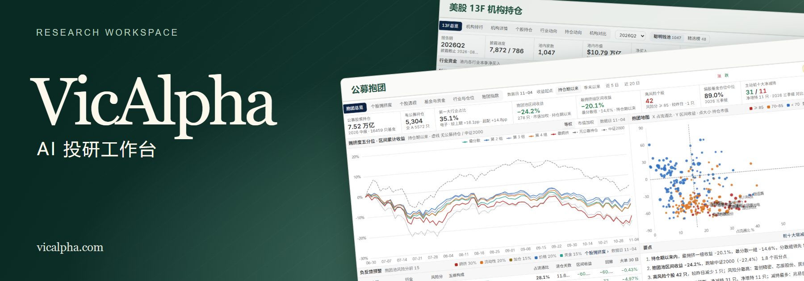](https://vicalpha.com/)

<h1 align="center">VicAlpha · AI 原生投研工作台</h1>

<b>为机构级投资研究而设计</b>

**用自然语言研究市场、开发策略、构建投研台。** 描述你关心的信号，VicAlpha 会实时跟踪，在条件满足时提醒你。

**多市场数据库**覆盖 A 股、港股、美股、ETF 和基金；**底层知识库**为公司分析、持仓研究和策略回测提供研究背景。

> **以行业轮动为例**　「哪些行业的资金流入正在加速？把它们放进投研台，回测一套轮动策略，并在行业满足入选条件时提醒我。」

**使用 [VicAlpha](https://vicalpha.com/) 开启专业投研与交易工作流。**

<strong><a href="#capabilities">✨ 核心功能</a> · <a href="#architecture">🏛️ 能力结构</a> · <a href="#desks">📊 投研台</a> · <a href="#strategies">🧪 策略与回测</a> · <a href="#signals">📡 实时信号</a></strong>

简体中文 | <a href="README.md">English</a> | <a href="README.zh-TW.md">繁體中文</a>

## ✨ 核心功能

| 🔎 研究与分析 | 📊 策略与回测 | 📡 跟踪与复盘 |
| --- | --- | --- |
| **15 个投研 Skills** · 分析公司、财报、市场与资金流 | **自然语言开发** · 从选股、择时规则到回测报告 | **实时信号** · 按方向、强度、事件筛选 |
| **22 个投研台入口** · 浏览或构建专题研究页 | **公共策略** · 查看参数、净值、回撤与分组表现 | **定时研究** · 按交易日或自定义周期跟踪 |

## 🏛️ 产品能力结构

**多市场数据库**与知识库提供研究资料，**Sandbox**（沙箱）提供研究执行环境。上层工作空间将这些基础能力与投研 Skills、策略回测和持续跟踪工具结合。

[查看 Mermaid 源码](images/platform-structure.mmd)

## 💬 研究工作空间与广场

你可以用自然语言发起研究，再沿同一条会话追问依据。例如：「今天半导体板块的上涨，是少数权重股带动，还是多数成分股都在涨？」

如果想先看一份成品，可以从研究广场浏览市场复盘、产业链报告和策略成果。回到工作空间，可以把自己的研究问题、会话和成果放在一起。

[**开始你的第一项研究 ↗**](https://vicalpha.com/)

| 研究入口 | 适合做什么 |
| --- | --- |
| 研究广场 | 按成果类型浏览公开研究，找到值得继续追问的问题。 |
| 工作空间 | 从新会话提出假设，保留上下文，从已有成果回到来源会话。 |

广场分别展示官方看板、社区报告和策略。可以按类型筛选或搜索，回到工作空间继续追问。

<table><tr><td width="50%" valign="top"><a href="images/research-plaza-dark.png">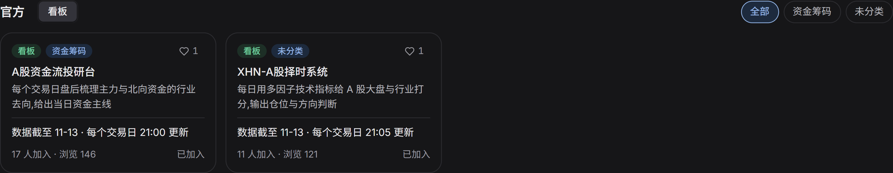</a> 研究广场的官方看板</td><td width="50%" valign="top"><a href="images/workspace-dark.png">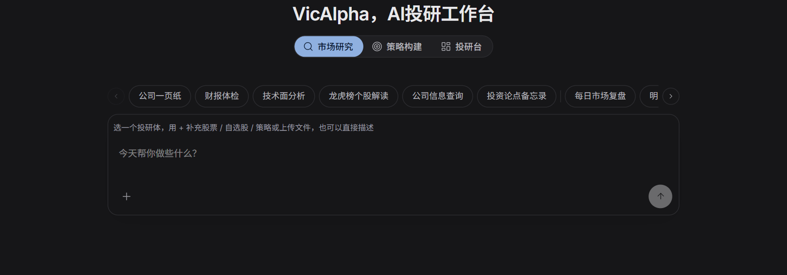</a> 自然语言投研工作空间</td></tr></table>

## 🧩 投研 Skills

你可以用自然语言指定研究任务。例如：「用财报体检分析这家公司，核对上期管理层承诺，并列出本期需要追问的异常变化。」

也可以直接选用 Skills 库中的 **15 个官方模板**。选择模板后即可开始对话，再补充标的、报告期或研究假设。

[**选择一个 Skill 开始研究 ↗**](https://vicalpha.com/skills)

| 官方分类 | 模板数 | 适用任务 |
| --- | --- | --- |
| 个股分析 | 6 | 公司一页纸、财报体检、技术面分析及投资论点论证。 |
| 市场研究 | 4 | 盘后复盘、市场环境研判与次日主线筛选。 |
| 资金流向 | 3 | 分析资金流向，跟踪国家队及龙虎榜动向。 |
| 投研台 | 2 | 围绕需要长期观察的问题开展投研台研究。 |

除了 15 个官方模板，也可以导入自己的 Skill。支持不超过 1 MB 的 ZIP、Markdown 或文本文件，也可直接粘贴研究方法。

<table><tr><td width="50%" valign="top"><a href="images/skills-library-dark.png">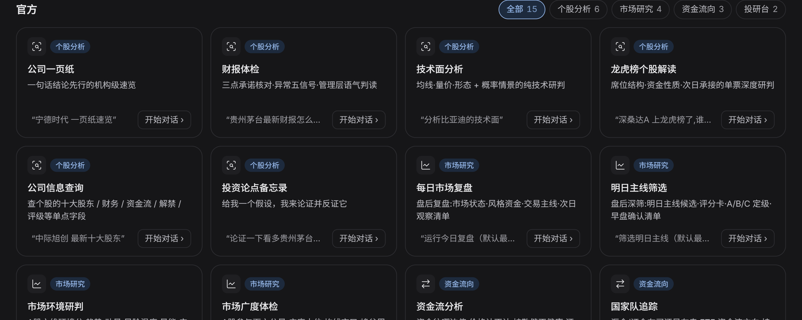</a> 官方 Skills 库</td><td width="50%" valign="top"><a href="images/skill-import-dark.png">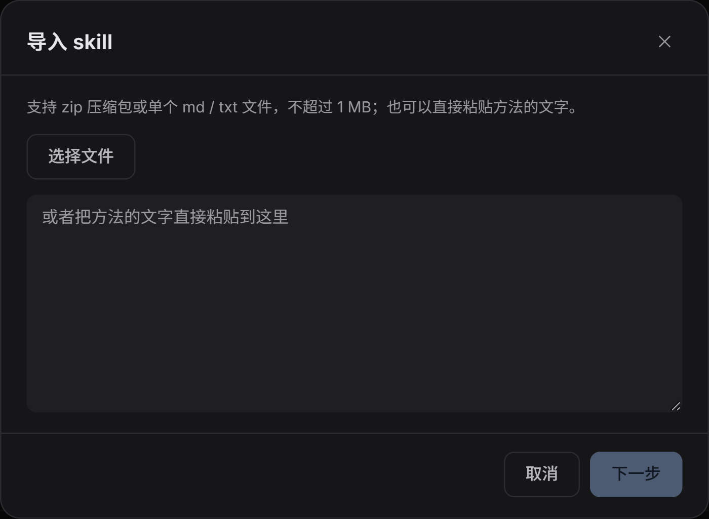</a> 导入 Skill</td></tr></table>

## 📊 投研台

你可以**用自然语言构建自己的机构级投研台**。描述你想研究的问题、需要对照的指标和希望跟踪的信号，例如「帮我搭建一个行业轮动投研台，把市场广度、行业资金流和择时信号放在一起」。

[投研台发现目录](https://vicalpha.com/tracker)截至 2026 年 11 月 13 日收录 **22 个投研台**。目录卡片可以预览图表与更新状态，也可按主题筛选。下方直达链接可能需要登录。配图以官网深色版为主，估值全景同时展示浅色版。

[**开始构建自己的第一个投研台 ↗**](https://vicalpha.com/tracker)

### 市场与策略

| 投研台 | 研究问题 | 页面与专题 |
| --- | --- | --- |
| [A 股行情](https://vicalpha.com/dashboard/trk_01M544AT6G7NJDN1DGTHD3TZWJ) | 市场涨跌由哪些板块带动？ | 行情、情绪、板块、资金与龙虎榜 |
| [市场状态](https://vicalpha.com/dashboard/trk_01M6GATFGCSW9T3W052JCYZP3D) | 市场情绪处于什么位置？ | 市场温度、维度分解、指标明细、信号事件与历史复盘 |
| [短线情绪](https://vicalpha.com/dashboard/trk_01M652CD3DX0AXP42X0KFD3ZYT) | 连板高度和题材热度如何演变？ | 连板天梯、题材主线、个股明细与次日表现 |
| [XHN-A股择时系统](https://vicalpha.com/live/trk_01M0Z1BYTTESV4KJRNQFY17243) | 左侧、同步与右侧信号何时一致？ | 综合看板、左侧抄底、同步跟踪、右侧逃顶与指标体系 |
| [逆向与反转](https://vicalpha.com/dashboard/trk_01M67TX7K5KDJ9TM5ZESM0CR7V) | 哪些低温行业出现拐点信号？ | 市场温度、行业逆向、候选榜、陷阱排雷与拐点信号 |
| [A 股产业链图谱](https://vicalpha.com/dashboard/trk_01M1R26Z79TDB92XS5M3ZA7AMJ) | 同一条产业链的上下游有哪些环节？ | 按产业链查看上中下游，并按环节或产品下钻 |
| [估值全景](https://vicalpha.com/dashboard/trk_01M6Q2NKK7Q19J7W87QZSB3FTC) | 主要指数相对自身历史处于什么估值位置？ | 宽基估值分位、指数详情、估值与收益、结构与对照 |
| [行业轮动](https://vicalpha.com/dashboard/trk_01M6XY338ES10G240KX1Q4KSB7) | 哪些行业正在走强？ | 覆盖 31 个申万一级行业的相对强弱、景气估值、资金拥挤与打分回测 |

<table><tr><td width="50%" valign="top"><a href="images/valuation-dark.png">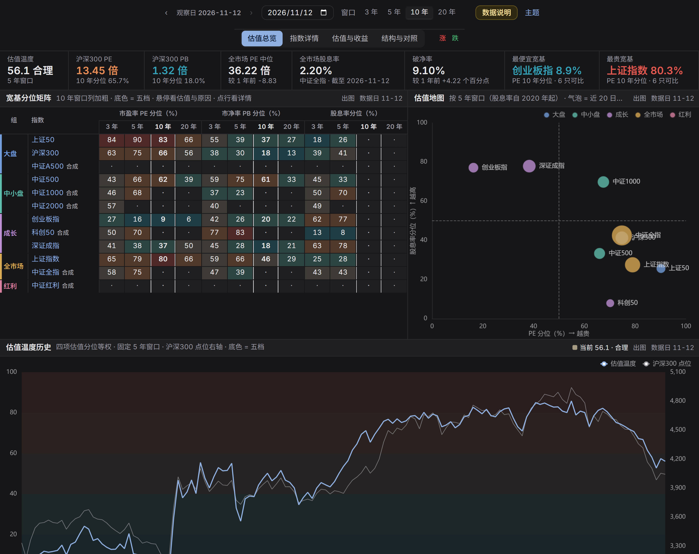</a> 估值全景 · 深色</td><td width="50%" valign="top"><a href="images/valuation-light.png">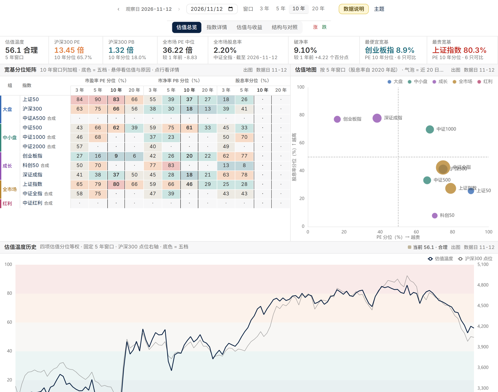</a> 估值全景 · 浅色</td></tr></table>

<table><tr><td width="50%" valign="top"><a href="images/sector-rotation-dark.png">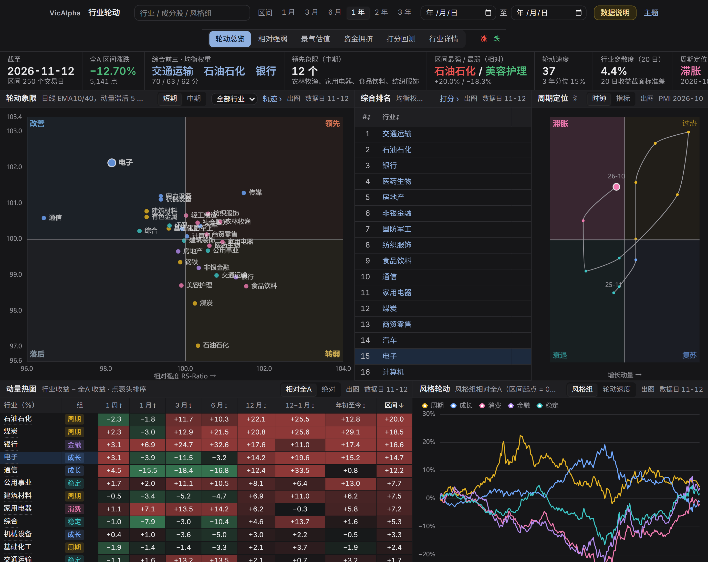</a> 行业轮动</td><td width="50%" valign="top"><a href="images/market-temperature-dark.png">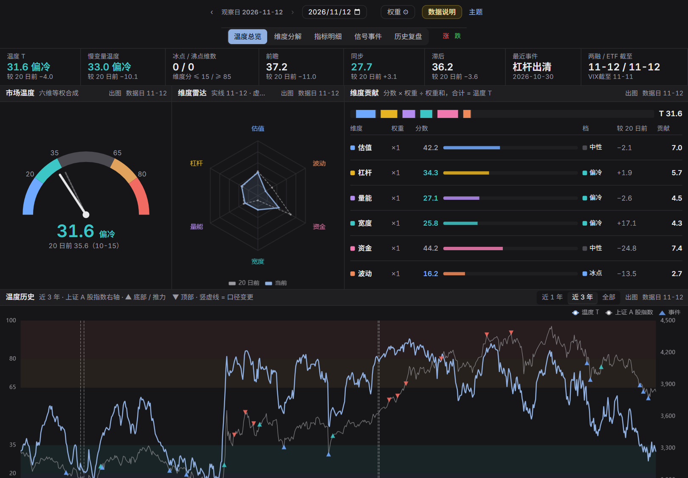</a> 市场状态</td></tr></table>

<table><tr><td width="50%" valign="top"><a href="images/timing-desk-dark.png">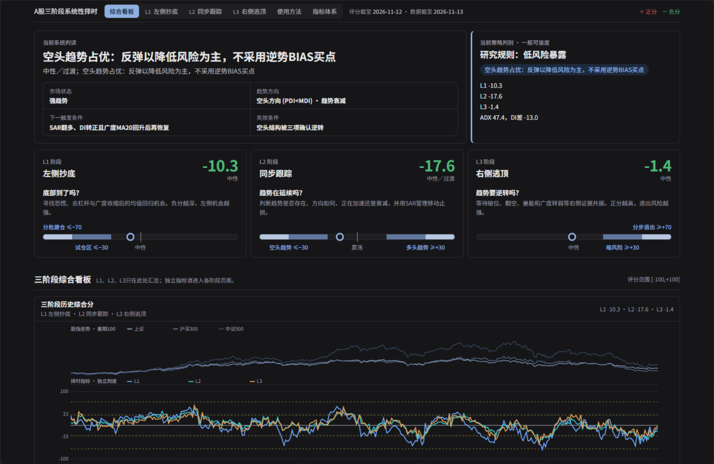</a> XHN-A股择时系统</td><td width="50%" valign="top"><a href="images/market-screen-dark.png">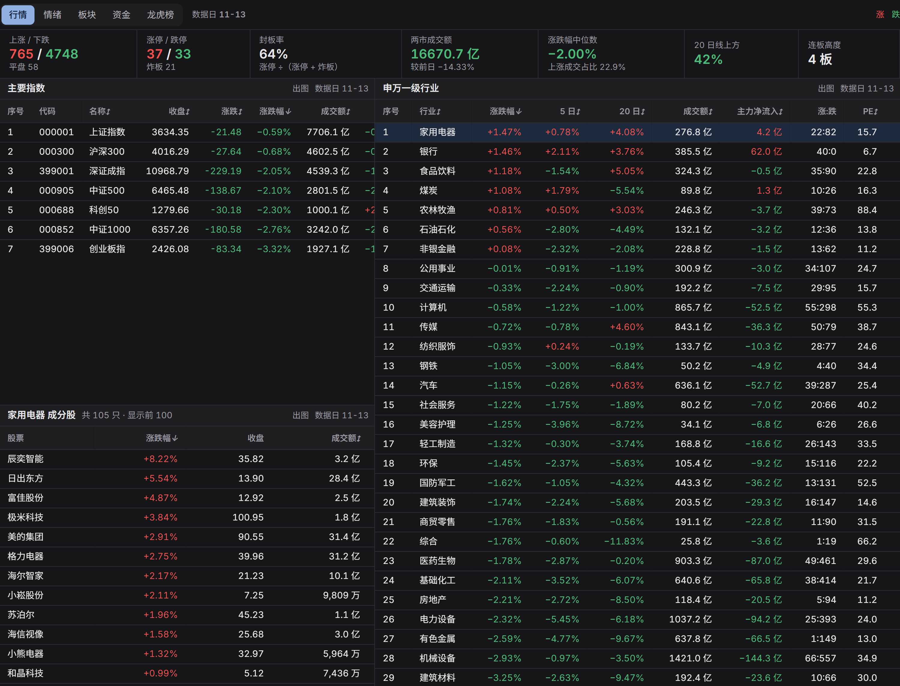</a> A 股行情</td></tr></table>

<table><tr><td width="50%" valign="top"><a href="images/industry-chain-pcb-dark.png">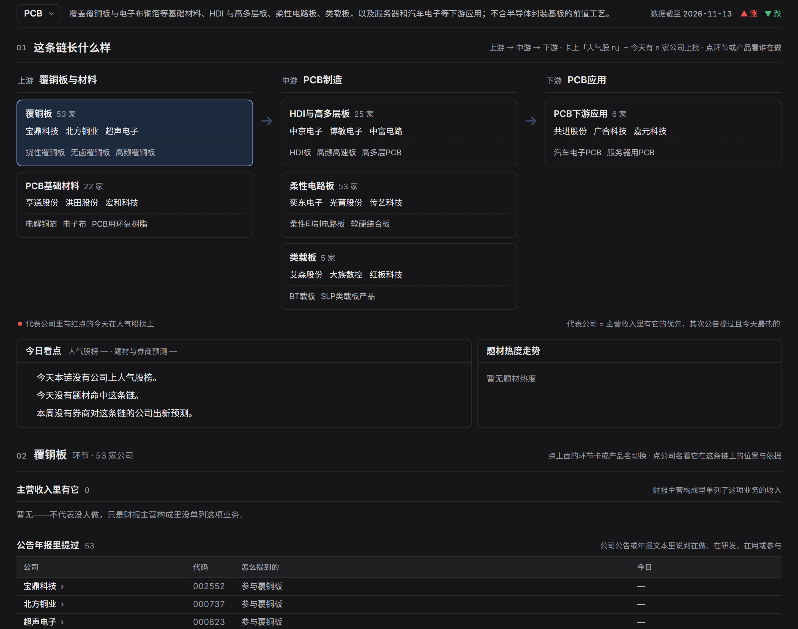</a> PCB 产业链图谱</td><td width="50%" valign="top"><a href="images/limit-up-dark.png">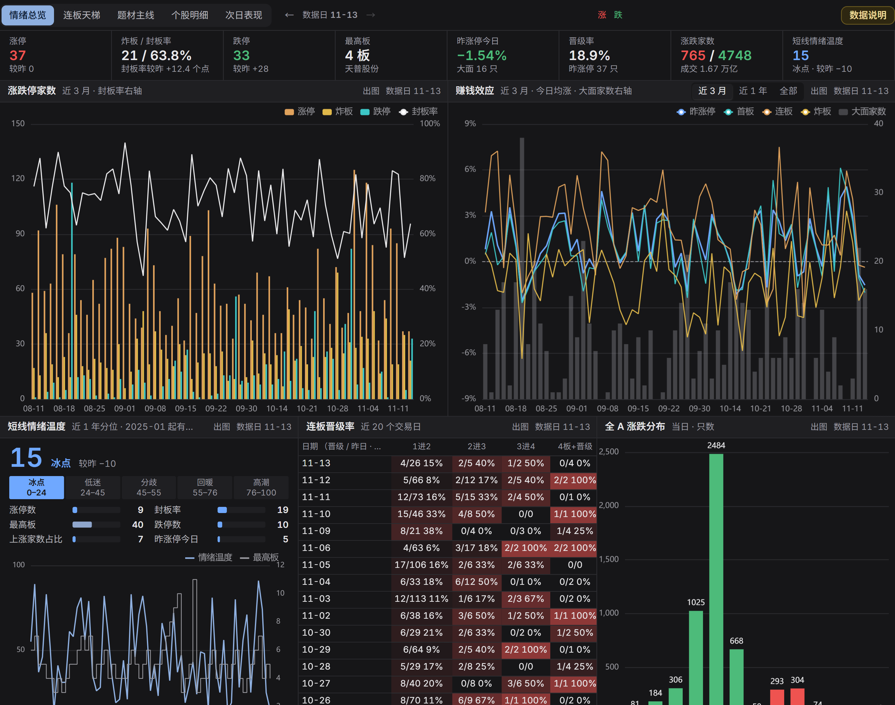</a> 短线情绪</td></tr></table>

### 资金与交易结构

| 投研台 | 研究问题 | 页面与专题 |
| --- | --- | --- |
| [A股资金流投研台](https://vicalpha.com/live/trk_01M0KE8SD5E4FC9TYVX82JSR05) | 如何从资金需求、供给与广度形成日度判断？ | 日度报告共 12 节，覆盖资金增量、供给、方向、广度、趋势、阶段、交易与口径 |
| [资金全景](https://vicalpha.com/dashboard/trk_01M5MH0K50GYYV6EMYT674E7KP) | 哪些渠道和板块的资金动向值得跟踪？ | 主力动向、板块、个股热图、两融、跨境、ETF、龙虎榜与产业资本 |
| [融资融券](https://vicalpha.com/dashboard/trk_01M61AJ1TDEH04E6QTJ82DAVJQ) | 杠杆周期走到哪里？哪些标的风险较高？ | 杠杆周期、行业和个股两融、风险监测 |
| [筹码结构](https://vicalpha.com/dashboard/trk_01M68EM7X3XGD7ZSFKGWQ0YMHR) | 不同板块的持仓成本和获利比例有何差异？ | 获利比例、成本集中度、行业筹码与个股筛选 |
| [交易拥挤度](https://vicalpha.com/dashboard/trk_01M5NRYV1THPTBNSA5QZTZXCQC) | 拥挤集中在哪些行业、风格和个股？ | 市场、行业、风格、个股拥挤度及机构持仓 |
| [股票供给](https://vicalpha.com/dashboard/trk_01M6K5FQ4ZM6J04MDHVCFX88Z8) | 如何跟踪发行、减持、回购与解禁压力？ | 解禁日历、IPO 与再融资、回购、减持与增持、供给与收益 |
| [ETF资金流](https://vicalpha.com/dashboard/trk_01M6J2TE6YHG3N1M1PTQYYR80Q) | 如何观察 ETF 净申购与成分股被动需求？ | 宽基、行业主题、产品、行业与个股穿透及影响分析 |
| [ETF信号选股](https://vicalpha.com/dashboard/trk_01M6V31YYRNG05Z89N19JAP4Z3) | ETF 资金与主动买入在哪些标的上共振？ | 个股拥挤、主动与被动资金交叉、主题轮动与主题详情 |

<table><tr><td width="50%" valign="top"><a href="images/etf-selection-dark.png">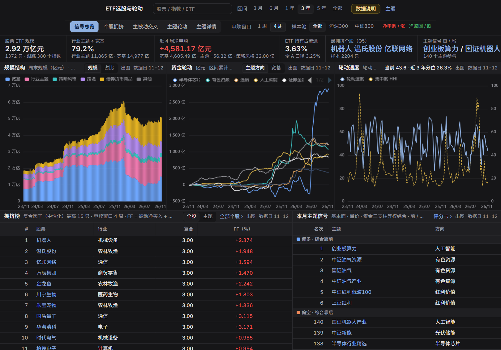</a> ETF信号选股</td><td width="50%" valign="top"><a href="images/etf-flows-dark.png">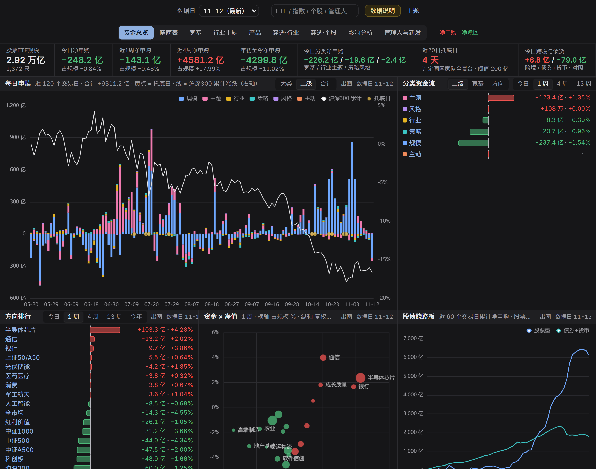</a> ETF资金流</td></tr></table>

<table><tr><td width="50%" valign="top"><a href="images/daily-flow-dark.png">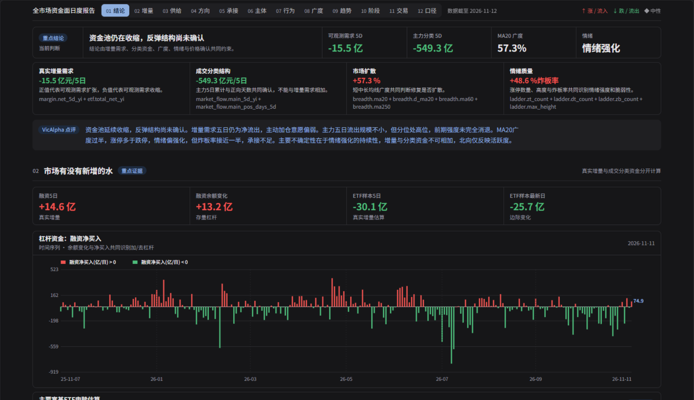</a> A股资金流投研台</td><td width="50%" valign="top"><a href="images/stock-supply-dark.png">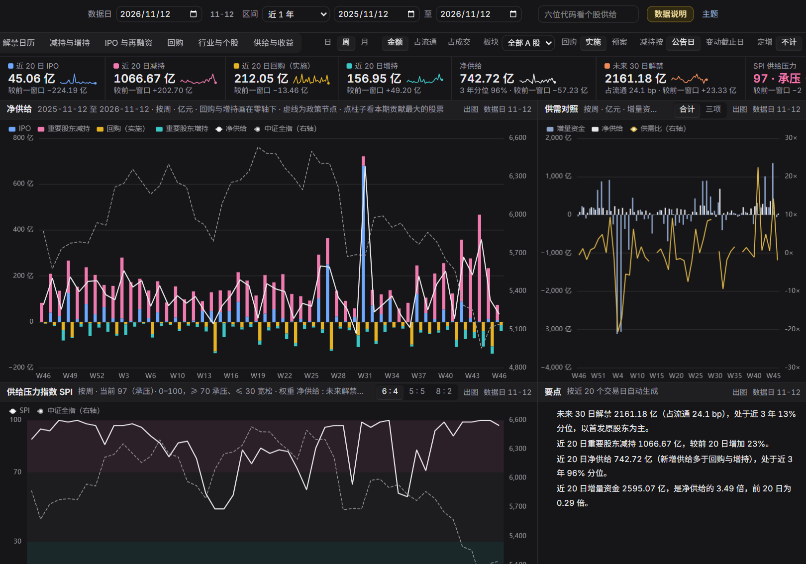</a> 股票供给</td></tr></table>

[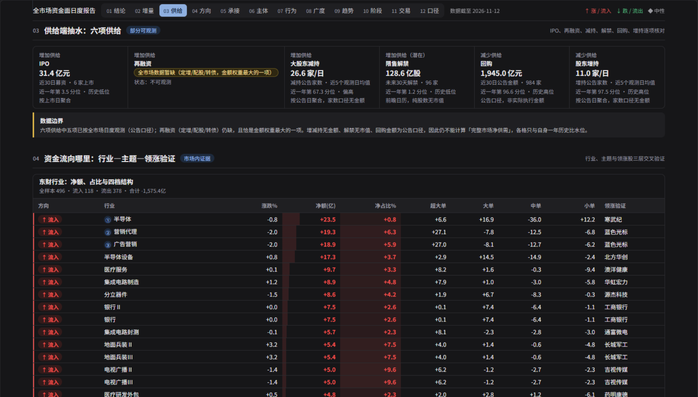](images/flow-direction-dark.png)

### 机构与持仓

| 投研台 | 研究问题 | 页面与专题 |
| --- | --- | --- |
| [公募抱团](https://vicalpha.com/dashboard/trk_01M61AH34C7CZVPRZABP2H6FNV) | 公募持仓集中在哪里？拥挤组的表现如何？ | 个股拥挤、基金与资金、行业仓位及抱团指数 |
| [公募持仓](https://vicalpha.com/dashboard/trk_01M6BNGVY94CDVMMTZFJX6VPV6) | 不同基金公司怎样配置行业和个股？ | 公募排行、个股持仓、行业动向、持仓热力与公司比较 |
| [美股机构持仓](https://vicalpha.com/dashboard/trk_01M1WKA7BJYSXWN5T2XN6EED58) | 哪些机构调整了持仓？行业分布如何变化？ | 13F 总览、机构排行与详情、个股持仓、行业与持仓动向、机构对比 |
| [国家队全景](https://vicalpha.com/dashboard/trk_01M6FBPM1THJ7KECTFKEQB8DMB) | 国家队通过哪些 ETF 和持股组合参与市场？ | ETF 托底、持股组合、持仓全景、调仓与主体详情 |
| [十大流通股东](https://vicalpha.com/dashboard/trk_01M55196PFQ2GNCF02D9YJMPMM) | 重要股东持有哪些标的？筹码是否更集中？ | 主体排行、个股股东、行业动向、筹码集中度与事件信号 |
| [机构调研](https://vicalpha.com/dashboard/trk_01M6MGXHV4JVMCNXJPVQ0K27FG) | 哪些公司受到机构调研关注？ | 上市公司、机构排行、基金经理、主题洞察及信号回测 |

<table><tr><td width="50%" valign="top"><a href="images/fund-holdings-dark.png">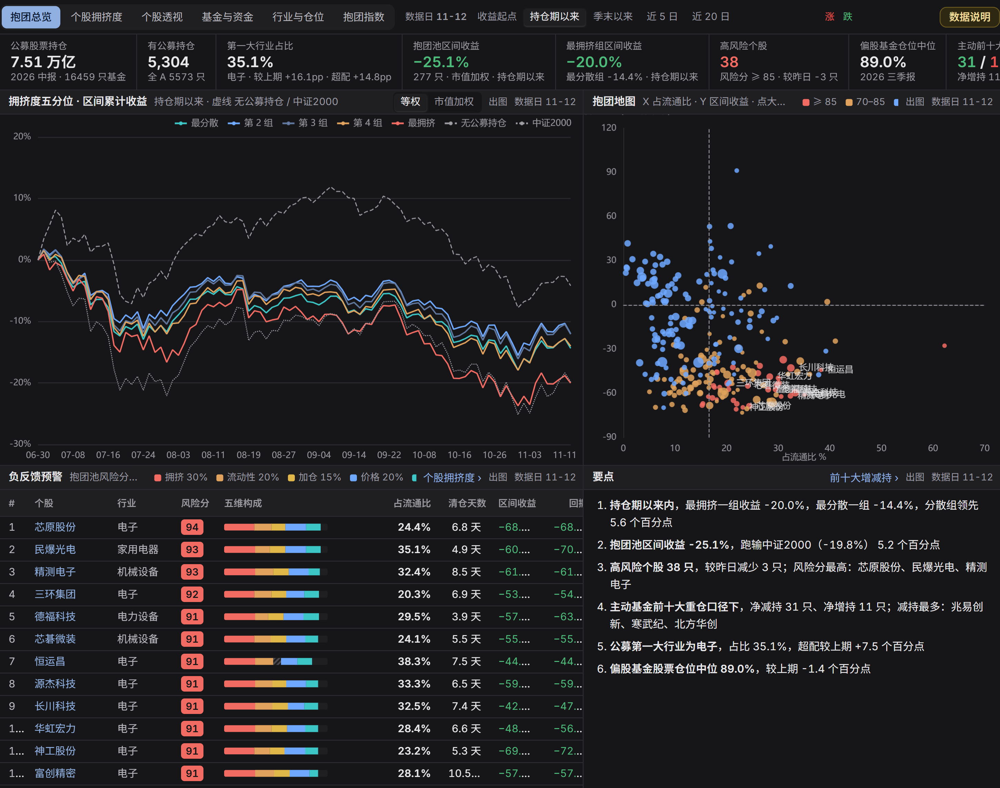</a> 公募抱团</td><td width="50%" valign="top"><a href="images/us-holdings-dark.png">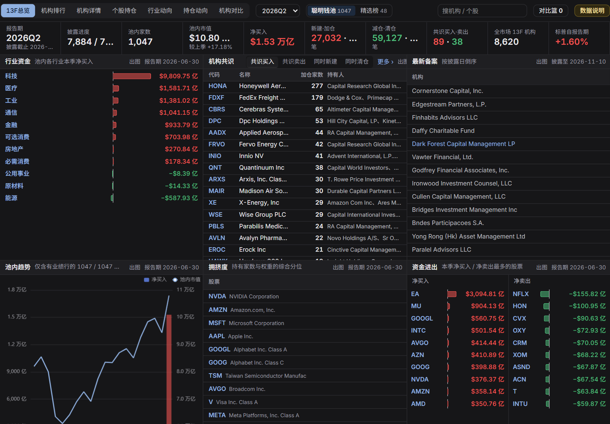</a> 美股机构持仓</td></tr></table>

<table><tr><td width="50%" valign="top"><a href="images/institutional-research-dark.png">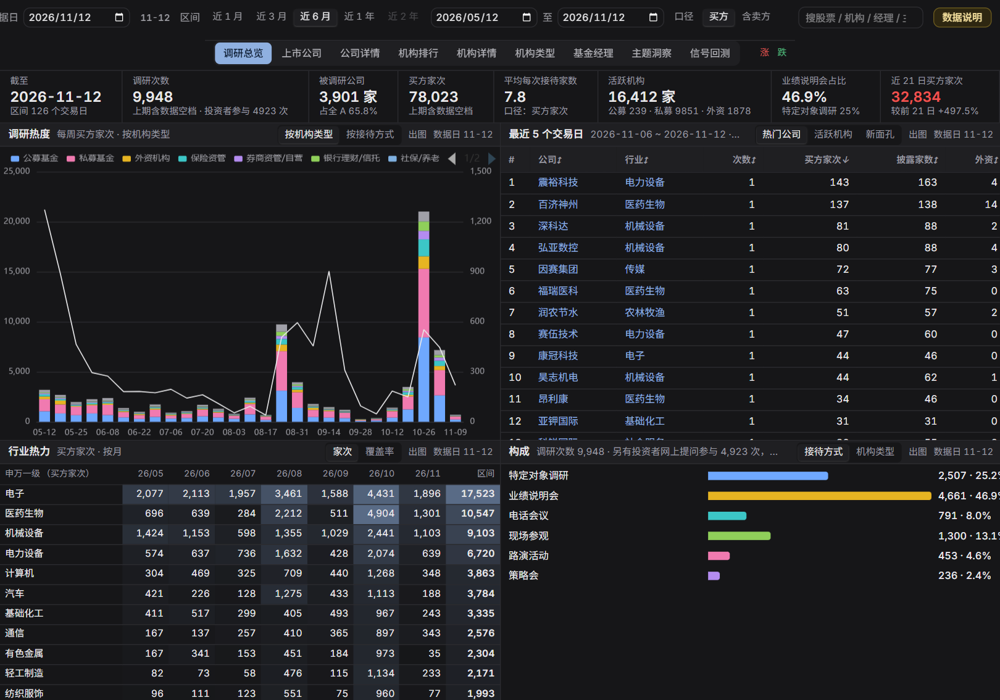</a> 机构调研</td><td width="50%" valign="top"><a href="images/desk-directory-dark.png">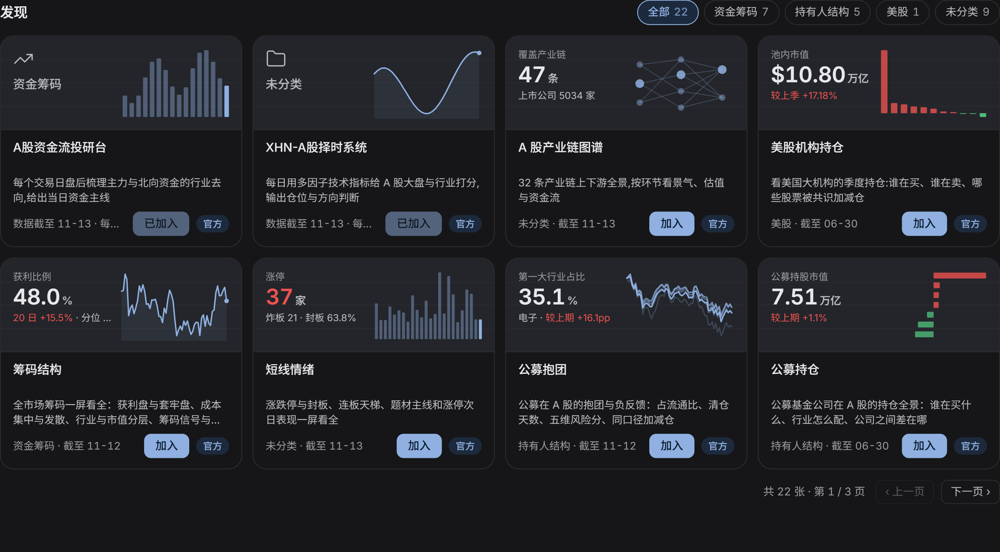</a> 投研台发现目录</td></tr></table>

## 🧪 AI 策略构建与回测

你可以从自己的交易假设开始，也可以选用官方策略作为起点。两种方式都可以结合历史回测，检查规则在什么条件下有效，以及为此承担了多大回撤。

### 自定义策略

你可以把交易想法写成可检验的规则。例如：「回测双均线择时策略，以沪深 300 为基准，比较不同参数下的收益和最大回撤。」

在工作空间选择「策略构建 → 策略回测」输入需求。也可以先读已有官方报告，看清策略采用的参数、适用行情和失效场景。

[**开始策略开发 ↗**](https://vicalpha.com/)

| 回测环节 | 要说明或检查的内容 |
| --- | --- |
| 提出需求 | 标的或样本池、比较基准、买卖规则，以及希望比较的参数。 |
| 解读报告 | 把收益与最大回撤、夏普放在一起看，再检查交易规则和样本表现分布。 |

<table><tr><td width="50%" valign="top"><a href="images/ai-backtest.png">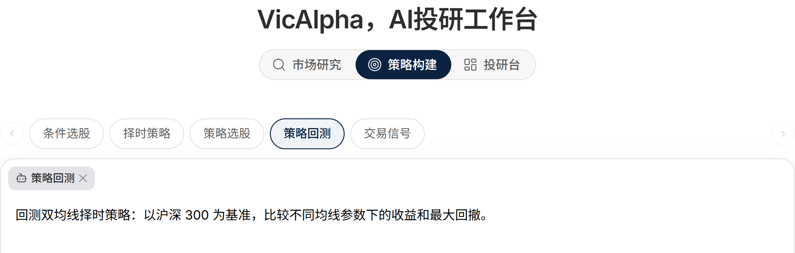</a> 自然语言输入 · 双均线需求示例</td><td width="50%" valign="top"><a href="images/strategy-report.png">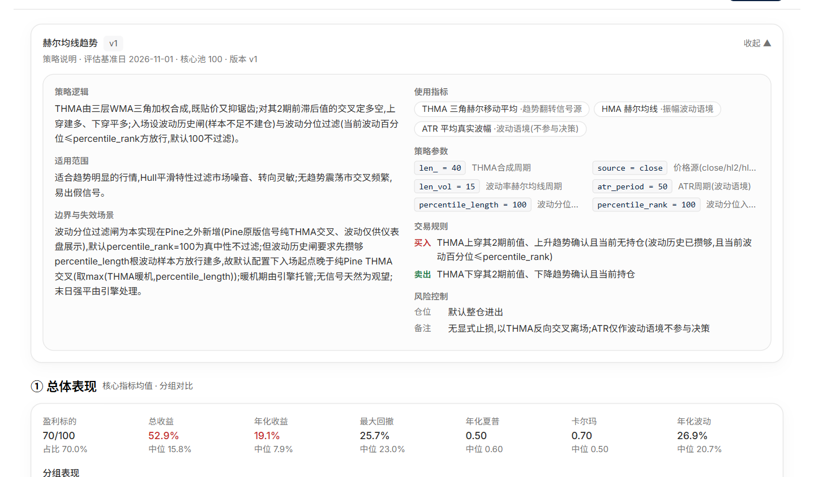</a> 已有官方报告 · 赫尔均线趋势</td></tr></table>

**历史会话实景 · 黄金 ETF SuperTrend**

左侧为策略开发对话，右侧为同一会话中打开的回测报告。报告覆盖 **2023-09-08 至 2026-09-07**，**总收益 29.29%**，**最大回撤 30.72%**。

### 公共策略

你可以从现成策略出发，再用自己的问题检验规则。例如：「比较低 PB 和 Piotroski F-Score：两者怎样选股，回撤表现有什么差异？」

截至 2026 年 11 月 13 日，公共策略库有 **26 个选股策略**和 **30 个择时策略**。卡片可预览回测表现分布，打开报告可查看规则、历史收益与回撤，也可以克隆策略继续研究。下表列出八个示例。

[**浏览公共策略库 ↗**](https://vicalpha.com/strategies)

[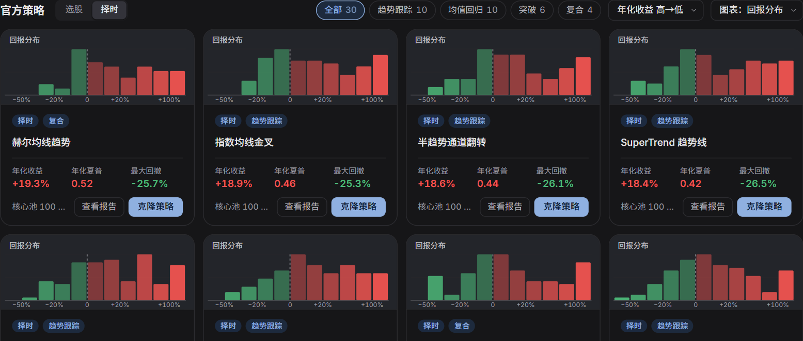](images/strategy-center-dark.png)

| 类型 | 策略 | 规则 | 历史回测 |
| --- | --- | --- | --- |
| 选股 · 价值 | 低 PB | 按账面价值相对市值筛选股票。 | [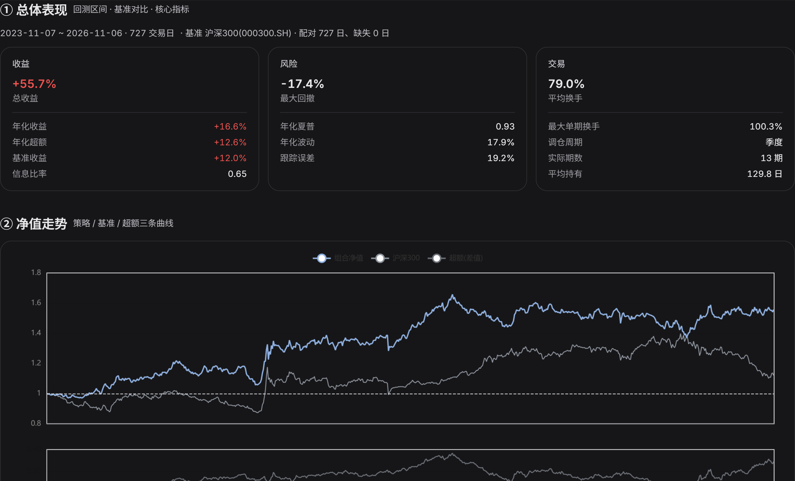](images/report-low-pb-dark.png) |
| 选股 · 质量 | Piotroski F-Score | 用九项财务信号衡量公司质量。 | [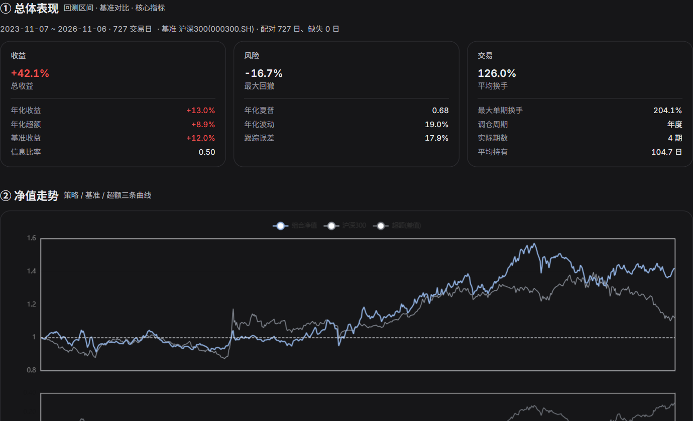](images/report-f-score-dark.png) |
| 选股 · 价值 | 聂夫总回报 | 结合低市盈率、适度增长和分红筛选公司。 | [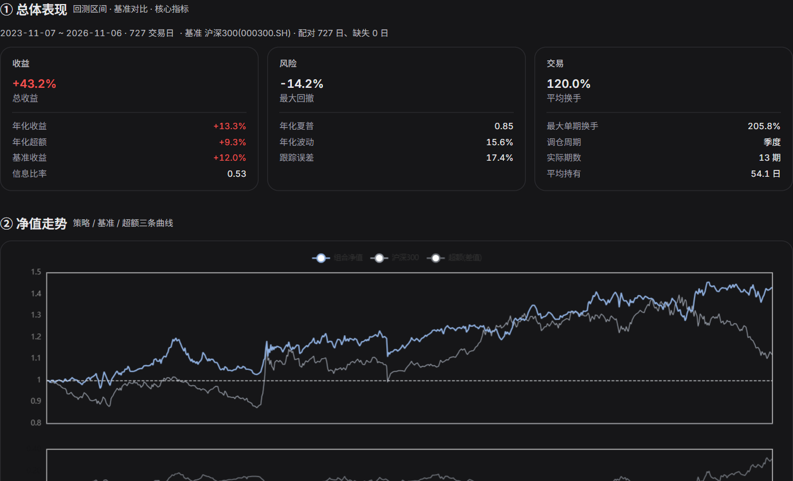](images/report-neff-dark.png) |
| 选股 · 资金流 | 基金持仓增持 | 关注公募持仓占比连续两个报告期上升的公司。 | [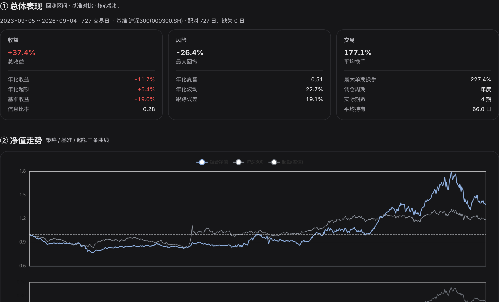](images/report-fund-increase-dark.png) |
| 择时 · 复合 | 赫尔均线趋势 | 观察赫尔均线相对前值的升降。 | [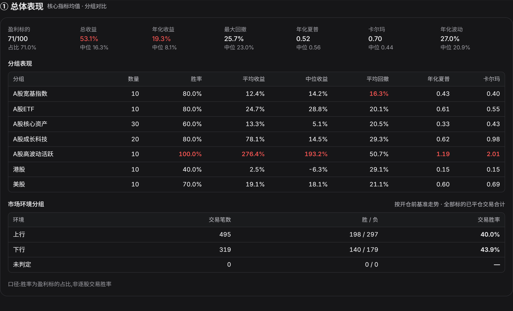](images/report-hull-dark.png) |
| 择时 · 趋势跟踪 | 指数均线金叉 | 以短期与长期指数移动平均线的交叉跟踪趋势。 | [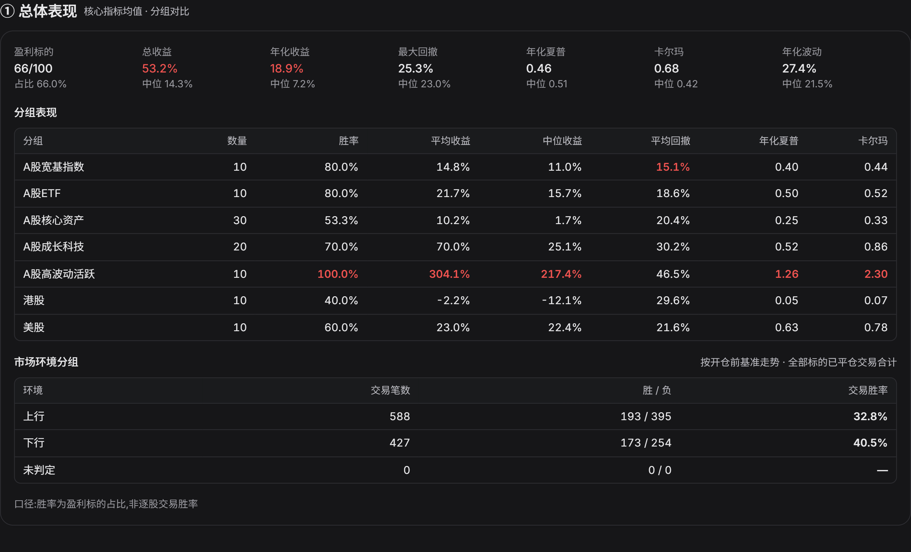](images/report-ema-dark.png) |
| 择时 · 趋势跟踪 | 半趋势通道翻转 | 用高低价格的平滑通道识别多空转换。 | [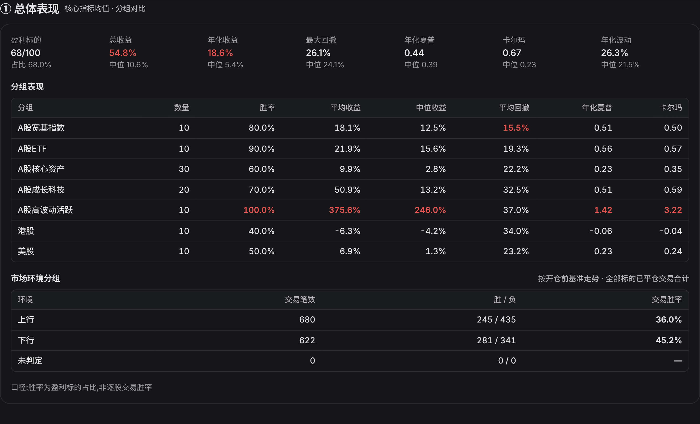](images/report-halftrend-dark.png) |
| 择时 · 趋势跟踪 | SuperTrend 趋势线 | 观察价格穿越基于 ATR 的轨道时，趋势方向是否翻转。 | [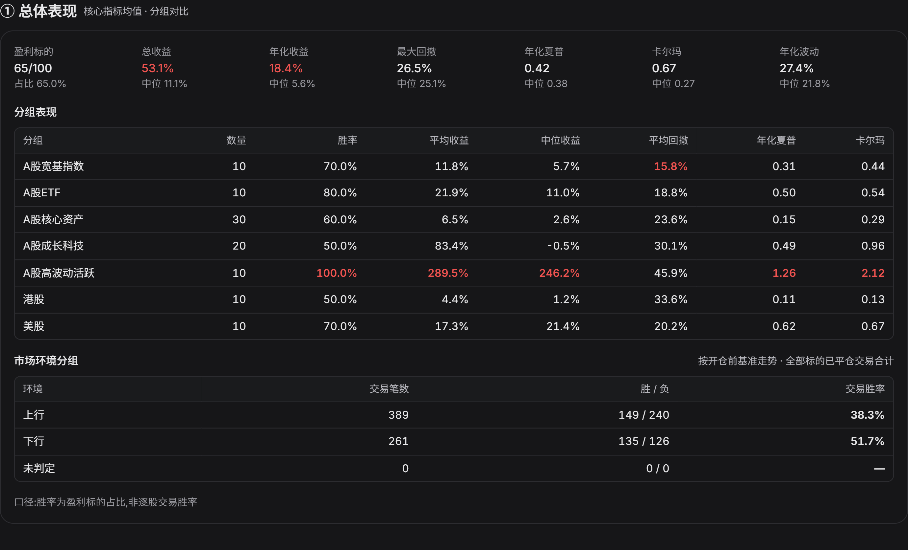](images/report-supertrend-dark.png) |

**历史回测精选**　按表中四个选股示例、四个择时示例各自的年化收益选取低 PB（**16.6%，最大回撤 17.4%**）与赫尔均线趋势（**19.3%，最大回撤 25.7%**）。前者是组合回测，后者是 100 个标的的均值。数值来自 2026 年 11 月 13 日查看的历史回测报告。

## 🔎 个股研究与跟踪

在个股研究页，你可以把股价变化与公司基本面对照起来。例如：「过去一年，公司股价相对沪深 300 的变化，是否与主营业务收入和利润变化一致？」

从概览进入行情、技术与筹码、资金、财务、估值、研报与预期、股东、机构持仓或公司事件。下图以贵州茅台为例，可直接看到行情摘要、价格对比、公司资料与主营构成。

[**开始个股研究与跟踪 ↗**](https://vicalpha.com/stock/600519.SH)

新版自选分为 **看盘、总览、风险与归因** 三个页面。进入个股详情，可查看估值、财务与公司事件。 [打开自选 ↗](https://vicalpha.com/watchlist)

| 观察维度 | 可用工具 |
| --- | --- |
| 公司研究 | 财务、估值、研报与预期、股东及机构持仓。 |
| 价格与趋势 | K 线、均线、布林带及复权切换。 |
| 量能与动量 | 成交量、MACD、KDJ 和 RSI 等指标。 |

[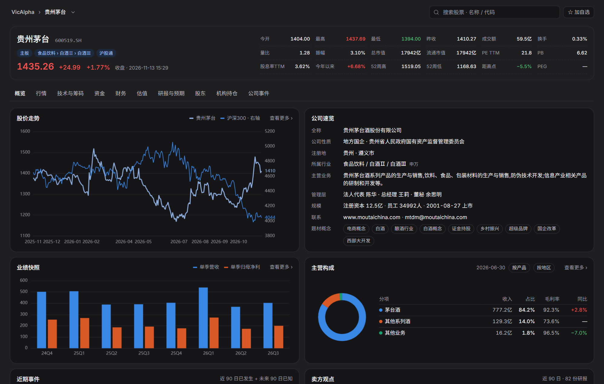](images/stock-page-dark.png)

## 📡 实时信号提醒

你可以用自然语言定义关注条件。例如：「当自选股满足我的择时策略入场条件时提醒我。」平台持续跟踪条件，在信号触发时提醒你。

在信号页，可以从信号流开始，再用类别、方向和强度缩小范围；想比较多只股票时，也可以切换列表或热力视图。

[**查看交易信号 ↗**](https://vicalpha.com/signal)

| 筛选维度 | 可选范围 |
| --- | --- |
| 信号来源 | 策略、技术、形态、量价、资金、事件。 |
| 阅读方式 | 按方向与强度筛选，按股票合并或逐条查看。 |

信号页支持按自选、宽基指数和行业选择股票池。可看当日、5 日、20 日或 60 日内的信号，并切换信号流、列表或热力视图。截图选用沪深 300 股票池。

[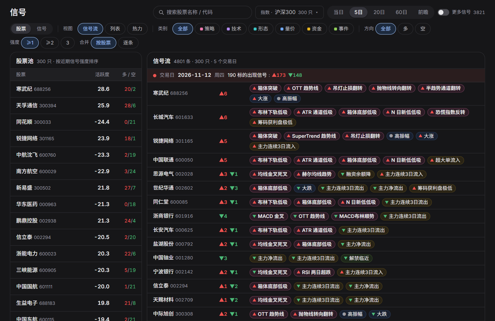](images/signal-page-dark.png)

## 🗓️ 定时研究任务

把重复研究写成一条带频率的指令。例如：「每个交易日收盘后，复盘 A 股市场广度、成交额和领涨行业。」

从任务页点「新建任务」描述需求。已有任务可以按类型、频率和执行状态查找，便于检查哪些研究仍在跟踪、哪些需要处理。

[**开始设置你的第一个定时任务 ↗**](https://vicalpha.com/jobs)

| 任务管理 | 可用选项 |
| --- | --- |
| 研究类型 | 报告、选股、回测与策略、简报等。 |
| 执行频率 | 单次、每天、每个交易日、每周、每月或自定义。 |
| 运行状态 | 启用、已暂停、异常、已停止。 |

[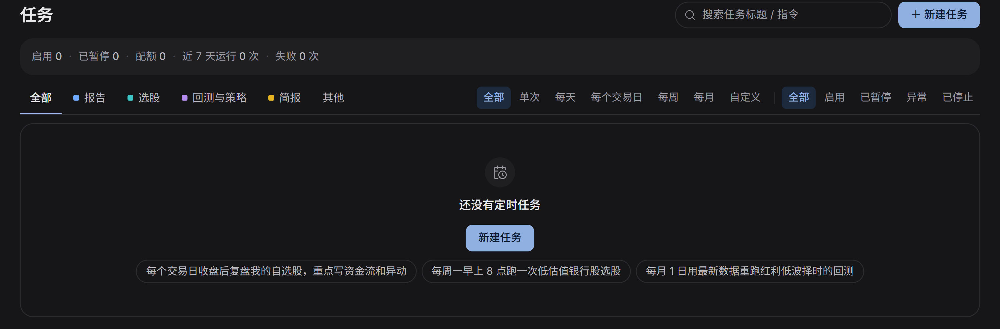](images/jobs-page-dark.png)

[打开 VicAlpha，开始研究 ↗](https://vicalpha.com/)

## 💬 联系方式

打开微信扫一扫，联系 VicAlpha。

