[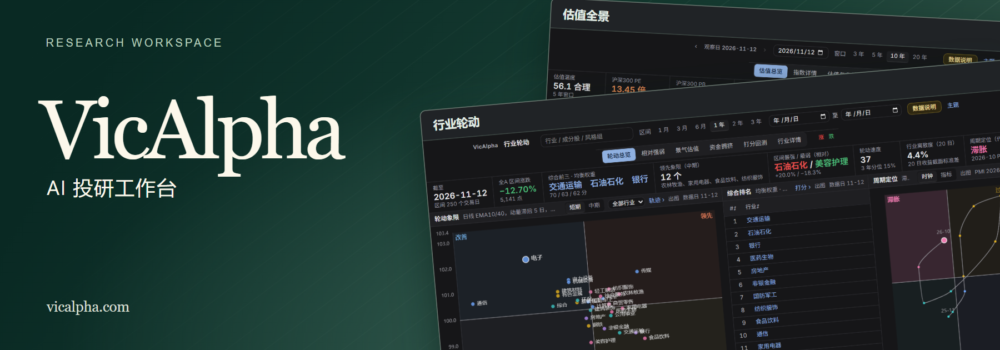](https://vicalpha.com/)

<h1 align="center">VicAlpha · AI 原生投研工作台</h1>

<b>為機構級投資研究而設計</b>

**用自然語言研究市場、開發策略、構建投研台。** 描述你關心的訊號，VicAlpha 會實時跟蹤，在條件滿足時提醒你。

**多市場資料庫**覆蓋 A 股、港股、美股、ETF 和基金；**底層知識庫**為公司分析、持倉研究和策略回測提供研究背景。

> **以行業輪動為例**　「哪些行業的資金流入正在加速？把它們放進投研台，回測一套輪動策略，並在行業滿足入選條件時提醒我。」

**使用 [VicAlpha](https://vicalpha.com/) 開啟專業投研與交易工作流。**

<strong><a href="#capabilities">✨ 核心功能</a> · <a href="#architecture">🏛️ 能力結構</a> · <a href="#desks">📊 投研台</a> · <a href="#strategies">🧪 策略與回測</a> · <a href="#signals">📡 即時訊號</a></strong>

<a href="README.zh-CN.md">简体中文</a> | <a href="README.md">English</a> | 繁體中文

## ✨ 核心功能

| 🔎 研究與分析 | 📊 策略與回測 | 📡 跟蹤與覆盤 |
| --- | --- | --- |
| **15 個投研 Skills** · 分析公司、財報、市場與資金流 | **自然語言開發** · 從選股、擇時規則到回測報告 | **實時訊號** · 按方向、強度、事件篩選 |
| **22 個投研台入口** · 瀏覽或構建專題研究頁 | **公共策略** · 檢視引數、淨值、回撤與分組表現 | **定時研究** · 按交易日或自定義週期跟蹤 |

## 🏛️ 產品能力結構

**多市場資料庫**與知識庫提供研究資料，**Sandbox**（沙箱）提供研究執行環境。上層工作空間將這些基礎能力與投研 Skills、策略回測和持續跟蹤工具結合。

[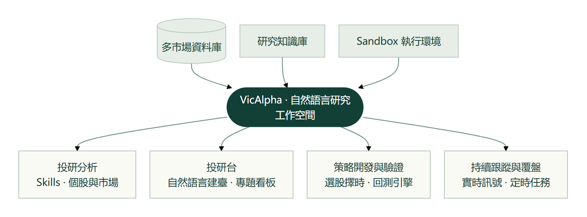](images/platform-structure-tw.png)

[檢視 Mermaid 原始碼](images/platform-structure-tw.mmd)

## 💬 研究工作空間與廣場

你可以用自然語言發起研究，再沿同一條會話追問依據。例如：「今天半導體板塊的上漲，是少數權重股帶動，還是多數成分股都在漲？」

如果想先看一份成品，可以從研究廣場瀏覽市場覆盤、產業鏈報告和策略成果。回到工作空間，可以把自己的研究問題、會話和成果放在一起。

[**開始你的第一項研究 ↗**](https://vicalpha.com/)

| 研究入口 | 適合做什麼 |
| --- | --- |
| 研究廣場 | 按成果型別瀏覽公開研究，找到值得繼續追問的問題。 |
| 工作空間 | 從新會話提出假設，保留上下文，從已有成果回到來源會話。 |

廣場分別展示官方看板、社群報告與策略。可以依類型篩選或搜尋，回到工作空間繼續追問。

<table><tr><td width="50%" valign="top"><a href="images/research-plaza-dark.png">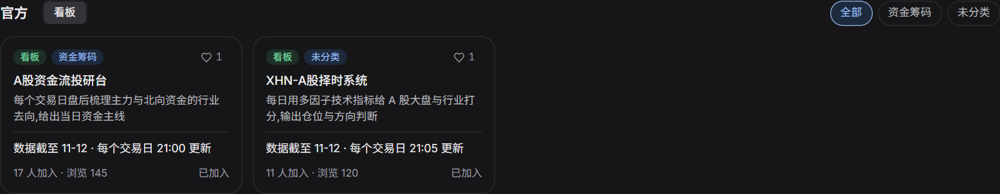</a> 研究廣場的官方看板</td><td width="50%" valign="top"><a href="images/workspace-dark.png">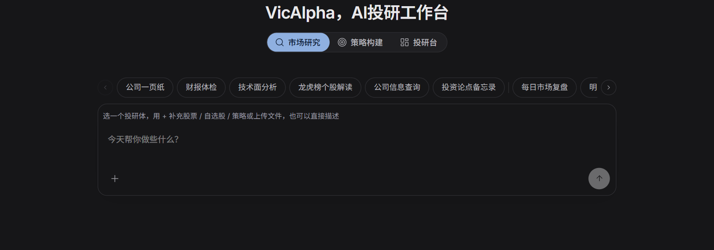</a> 自然語言投研工作空間</td></tr></table>

## 🧩 投研 Skills

你可以用自然語言指定研究任務。例如：「用財報體檢分析這家公司，核對上期管理層承諾，並列出本期需要追問的異常變化。」

也可以直接選用 Skills 庫中的 **15 個官方模板**。選擇模板後即可開始對話，再補充標的、報告期或研究假設。

[**選擇一個 Skill 開始研究 ↗**](https://vicalpha.com/skills)

| 官方分類 | 模板數 | 適用任務 |
| --- | --- | --- |
| 個股分析 | 6 | 公司一頁紙、財報體檢、技術面分析及投資論點論證。 |
| 市場研究 | 4 | 盤後覆盤、市場環境研判與次日主線篩選。 |
| 資金流向 | 3 | 分析資金流向，跟蹤國家隊及龍虎榜動向。 |
| 投研台 | 2 | 圍繞需要長期觀察的問題開展投研台研究。 |

除了 15 個官方範本，也可以匯入自己的 Skill。支援不超過 1 MB 的 ZIP、Markdown 或文字檔，也可直接貼上研究方法。

<table><tr><td width="50%" valign="top"><a href="images/skills-library-dark.png">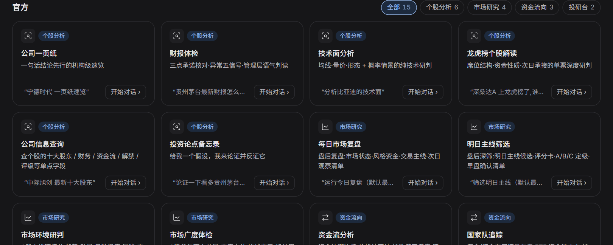</a> 官方 Skills 庫</td><td width="50%" valign="top"><a href="images/skill-import-dark.png">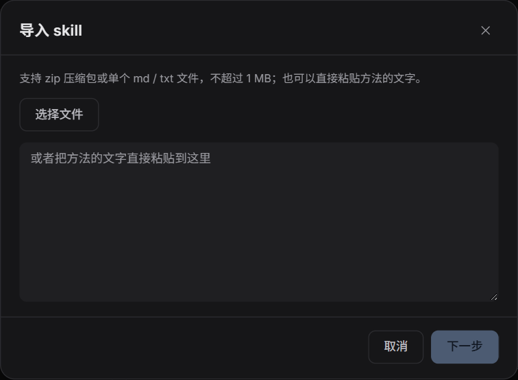</a> 匯入 Skill</td></tr></table>

## 📊 投研台

你可以**用自然語言構建自己的機構級投研台**。描述你想研究的問題、需要對照的指標和希望跟蹤的訊號，例如「幫我搭建一個行業輪動投研台，把市場廣度、行業資金流和擇時訊號放在一起」。

[投研台發現目錄](https://vicalpha.com/tracker)截至 2026 年 11 月 13 日收錄 **22 個投研台**。目錄卡片可以預覽圖表與更新狀態，也可依主題篩選。下方直達連結可能需要登入。配圖以官網深色版為主，估值全景同時展示淺色版。

[**開始構建自己的第一個投研台 ↗**](https://vicalpha.com/tracker)

### 市場與策略

| 投研台 | 研究問題 | 頁面與專題 |
| --- | --- | --- |
| [A 股行情](https://vicalpha.com/dashboard/trk_01M544AT6G7NJDN1DGTHD3TZWJ) | 市場漲跌由哪些板塊帶動？ | 行情、情緒、板塊、資金與龍虎榜 |
| [市場狀態](https://vicalpha.com/dashboard/trk_01M6GATFGCSW9T3W052JCYZP3D) | 市場情緒處於什麼位置？ | 市場溫度、維度分解、指標明細、訊號事件與歷史復盤 |
| [短線情緒](https://vicalpha.com/dashboard/trk_01M652CD3DX0AXP42X0KFD3ZYT) | 連板高度和題材熱度如何演變？ | 連板天梯、題材主線、個股明細與次日表現 |
| [XHN-A股擇時系統](https://vicalpha.com/live/trk_01M0Z1BYTTESV4KJRNQFY17243) | 左側、同步與右側訊號何時一致？ | 綜合看板、左側抄底、同步追蹤、右側逃頂與指標體系 |
| [逆向與反轉](https://vicalpha.com/dashboard/trk_01M67TX7K5KDJ9TM5ZESM0CR7V) | 哪些低溫行業出現拐點訊號？ | 市場溫度、產業逆向、候選榜、陷阱排雷與轉折訊號 |
| [A 股產業鏈圖譜](https://vicalpha.com/dashboard/trk_01M1R26Z79TDB92XS5M3ZA7AMJ) | 同一條產業鏈的上下游有哪些環節？ | 按產業鏈檢視上中下游，並依環節或產品深入查看 |
| [估值全景](https://vicalpha.com/dashboard/trk_01M6Q2NKK7Q19J7W87QZSB3FTC) | 主要指數相對自身歷史處於什麼估值位置？ | 寬基估值百分位、指數詳情、估值與報酬、結構與對照 |
| [產業輪動](https://vicalpha.com/dashboard/trk_01M6XY338ES10G240KX1Q4KSB7) | 哪些產業正在走強？ | 涵蓋 31 個申萬一級產業的相對強弱、景氣估值、資金擁擠度與評分回測 |

<table><tr><td width="50%" valign="top"><a href="images/valuation-dark.png">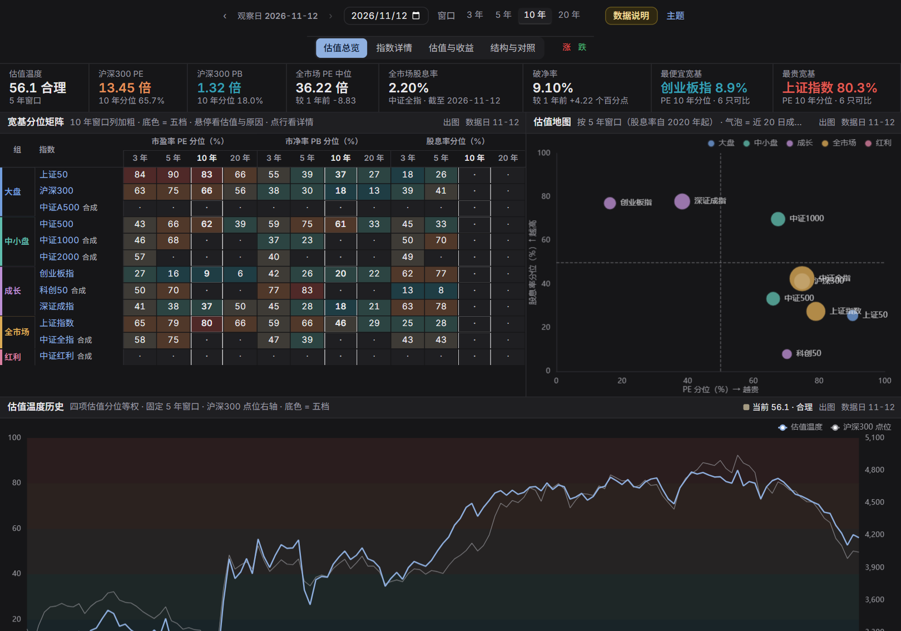</a> 估值全景 · 深色</td><td width="50%" valign="top"><a href="images/valuation-light.png">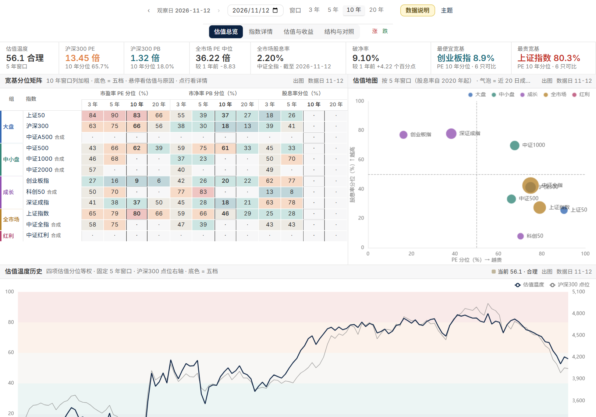</a> 估值全景 · 淺色</td></tr></table>

<table><tr><td width="50%" valign="top"><a href="images/sector-rotation-dark.png">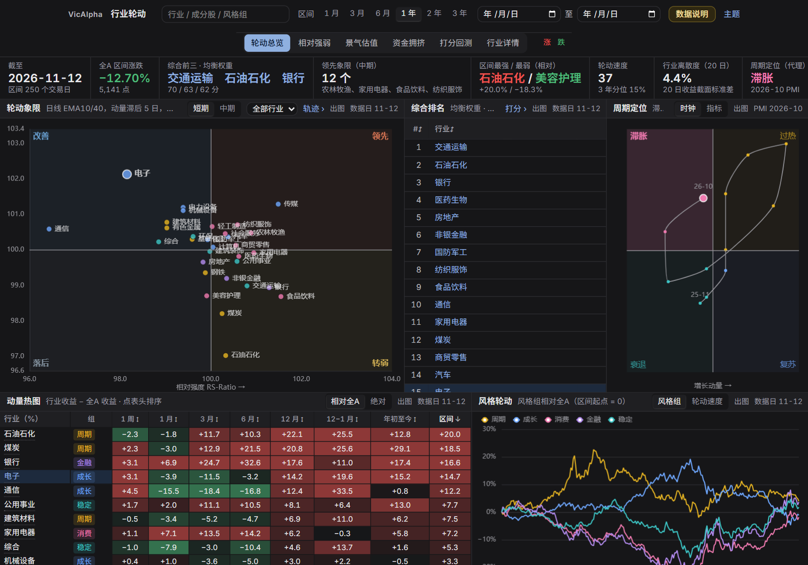</a> 產業輪動</td><td width="50%" valign="top"><a href="images/market-temperature-dark.png">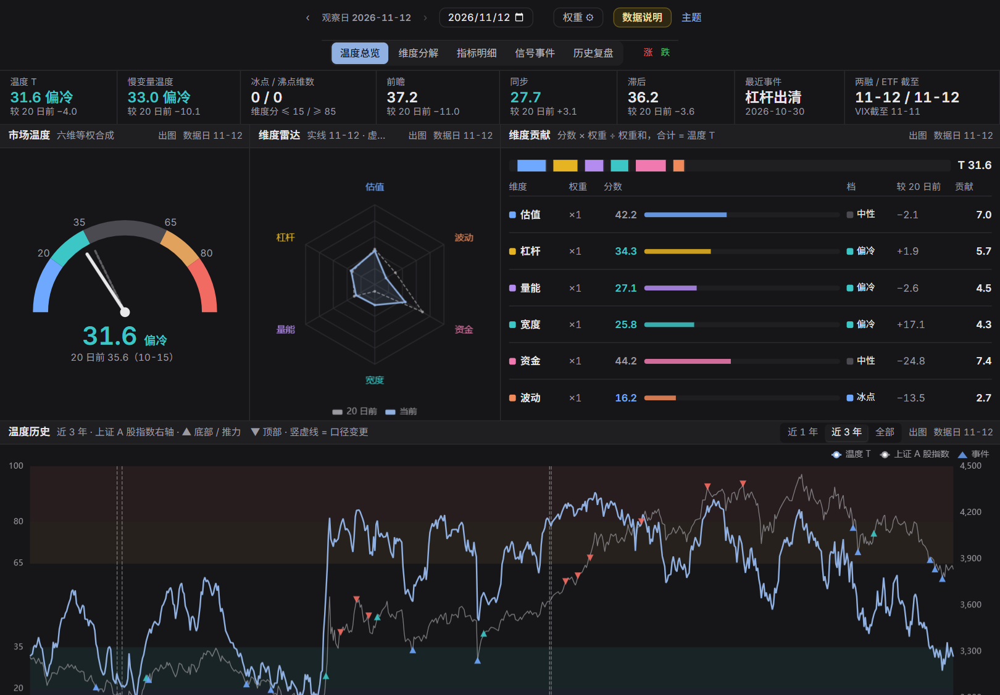</a> 市場狀態</td></tr></table>

<table><tr><td width="50%" valign="top"><a href="images/timing-desk-dark.png">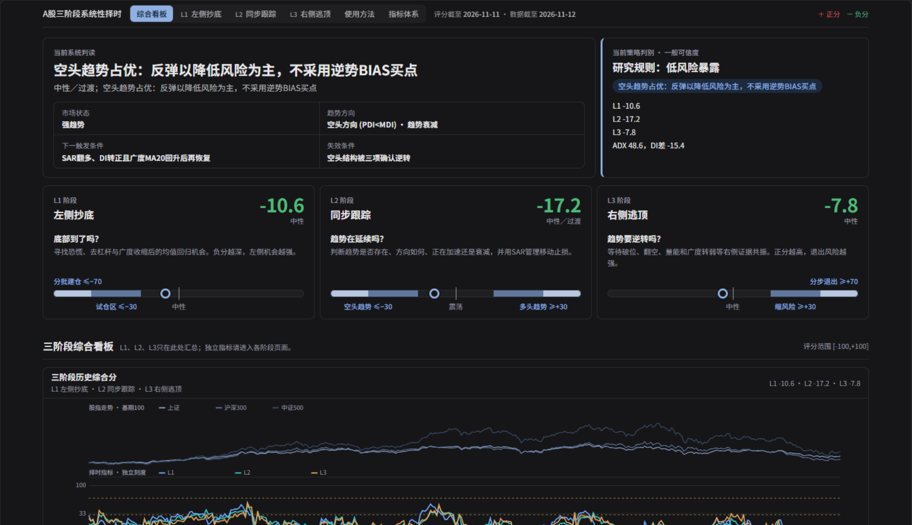</a> XHN-A股擇時系統</td><td width="50%" valign="top"><a href="images/market-screen-dark.png">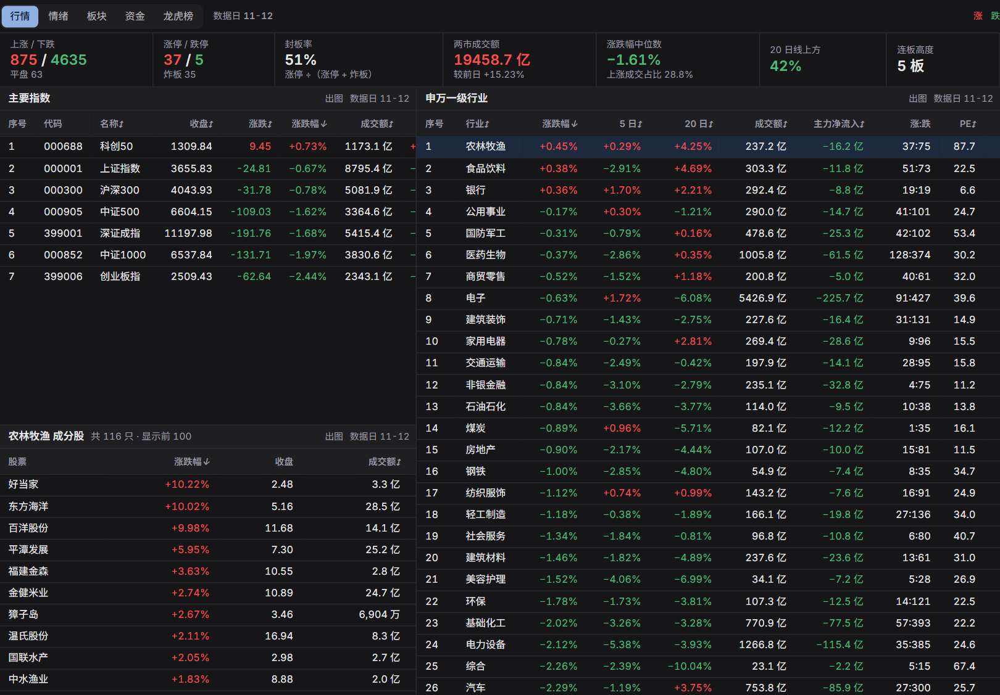</a> A 股行情</td></tr></table>

<table><tr><td width="50%" valign="top"><a href="images/industry-chain-pcb-dark.png">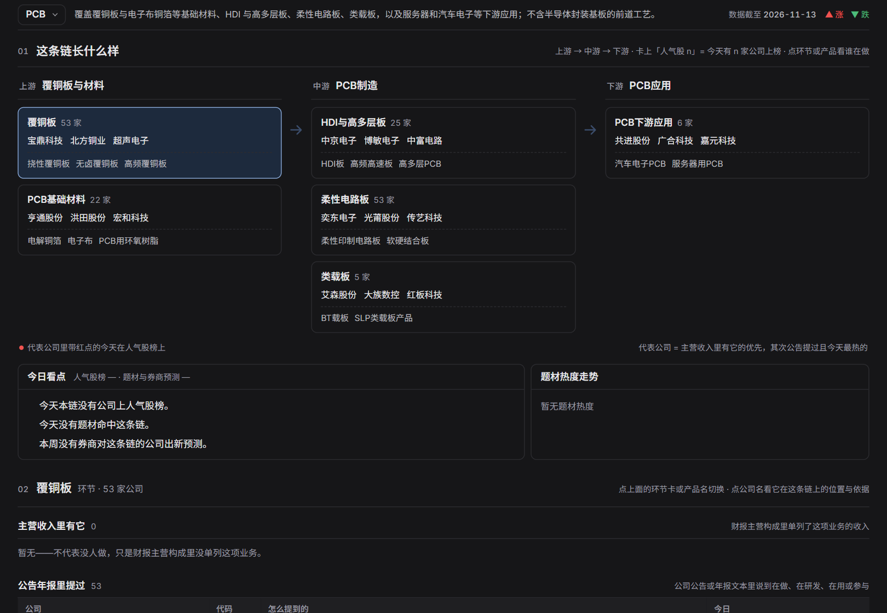</a> PCB 產業鏈圖譜</td><td width="50%" valign="top"><a href="images/limit-up-dark.png">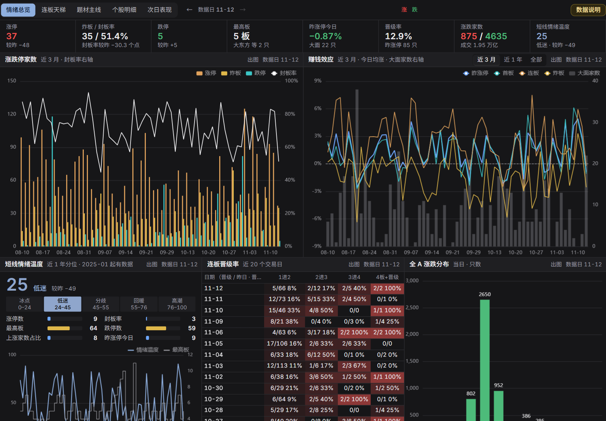</a> 短線情緒</td></tr></table>

### 資金與交易結構

| 投研台 | 研究問題 | 頁面與專題 |
| --- | --- | --- |
| [A股資金流投研台](https://vicalpha.com/live/trk_01M0KE8SD5E4FC9TYVX82JSR05) | 如何從資金需求、供給與廣度形成日度判斷？ | 每日報告共 12 節，涵蓋資金增量、供給、方向、廣度、趨勢、階段、交易與統計口徑 |
| [資金全景](https://vicalpha.com/dashboard/trk_01M5MH0K50GYYV6EMYT674E7KP) | 哪些渠道和板塊的資金動向值得跟蹤？ | 主力動向、板塊、個股熱圖、兩融、跨境、ETF、龍虎榜與產業資本 |
| [融資融券](https://vicalpha.com/dashboard/trk_01M61AJ1TDEH04E6QTJ82DAVJQ) | 槓桿週期走到哪裡？哪些標的風險較高？ | 槓桿週期、產業與個股兩融、風險監測 |
| [籌碼結構](https://vicalpha.com/dashboard/trk_01M68EM7X3XGD7ZSFKGWQ0YMHR) | 不同板塊的持倉成本和獲利比例有何差異？ | 獲利比例、成本集中度、產業籌碼與個股篩選 |
| [交易擁擠度](https://vicalpha.com/dashboard/trk_01M5NRYV1THPTBNSA5QZTZXCQC) | 擁擠集中在哪些行業、風格和個股？ | 市場、產業、風格、個股擁擠度及機構持倉 |
| [股票供給](https://vicalpha.com/dashboard/trk_01M6K5FQ4ZM6J04MDHVCFX88Z8) | 如何跟蹤發行、減持、回購與解禁壓力？ | 解禁日曆、IPO 與再融資、庫藏股、增減持及供給與報酬 |
| [ETF資金流](https://vicalpha.com/dashboard/trk_01M6J2TE6YHG3N1M1PTQYYR80Q) | 如何觀察 ETF 淨申購與成分股被動需求？ | 寬基、產業主題、產品、產業與個股穿透及影響分析 |
| [ETF訊號選股](https://vicalpha.com/dashboard/trk_01M6V31YYRNG05Z89N19JAP4Z3) | ETF 資金與主動買入在哪些標的上重疊？ | 個股擁擠、主動與被動資金交叉、主題輪動與主題詳情 |

<table><tr><td width="50%" valign="top"><a href="images/etf-selection-dark.png">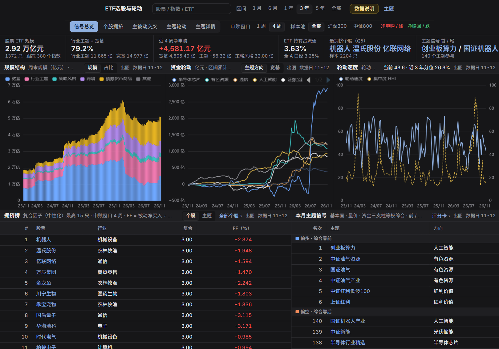</a> ETF訊號選股</td><td width="50%" valign="top"><a href="images/etf-flows-dark.png">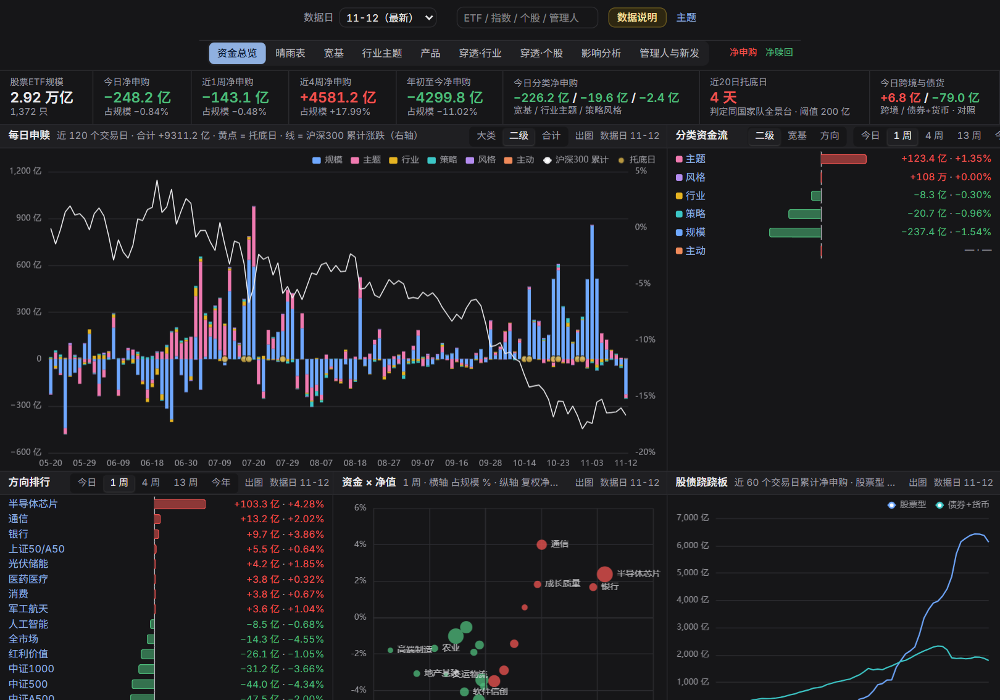</a> ETF資金流</td></tr></table>

<table><tr><td width="50%" valign="top"><a href="images/daily-flow-dark.png">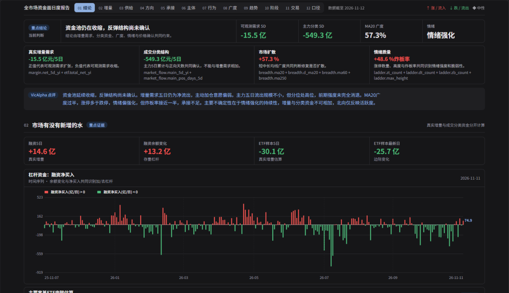</a> A股資金流投研台</td><td width="50%" valign="top"><a href="images/stock-supply-dark.png">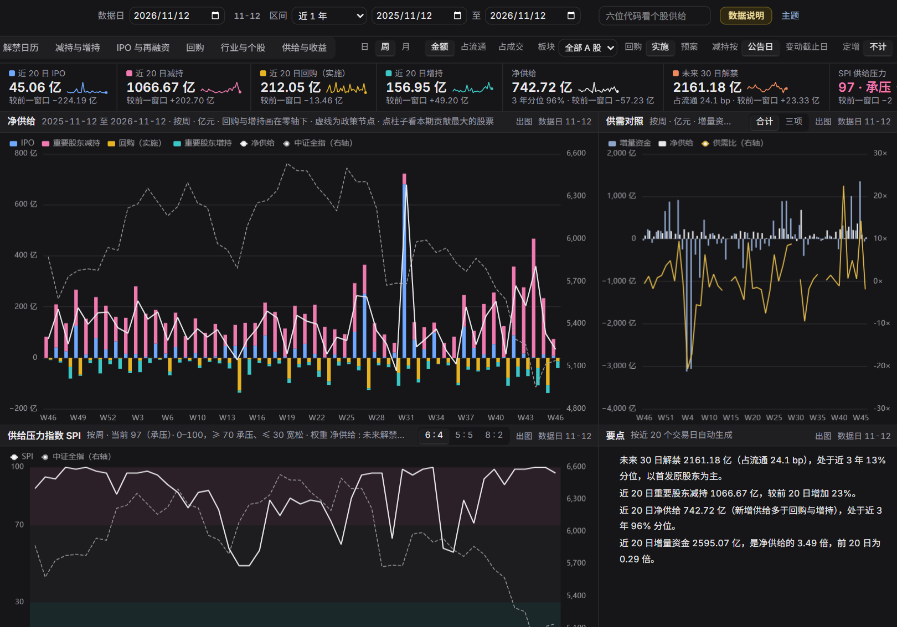</a> 股票供給</td></tr></table>

[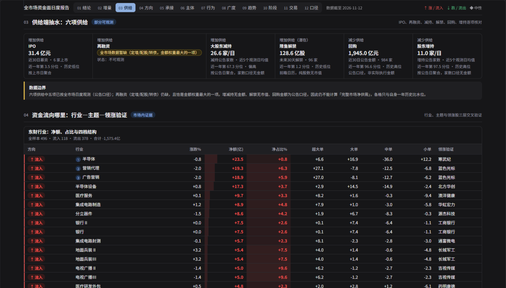](images/flow-direction-dark.png)

### 機構與持倉

| 投研台 | 研究問題 | 頁面與專題 |
| --- | --- | --- |
| [公募抱團](https://vicalpha.com/dashboard/trk_01M61AH34C7CZVPRZABP2H6FNV) | 公募持倉集中在哪裡？擁擠組的表現如何？ | 個股擁擠、基金與資金、產業持倉及抱團指數 |
| [公募持倉](https://vicalpha.com/dashboard/trk_01M6BNGVY94CDVMMTZFJX6VPV6) | 不同基金公司怎樣配置行業和個股？ | 公募排行、個股持倉、產業動向、持倉熱圖與公司比較 |
| [美股機構持倉](https://vicalpha.com/dashboard/trk_01M1WKA7BJYSXWN5T2XN6EED58) | 哪些機構調整了持倉？行業分佈如何變化？ | 13F 總覽、機構排行與詳情、個股持倉、產業與持倉動向、機構比較 |
| [國家隊全景](https://vicalpha.com/dashboard/trk_01M6FBPM1THJ7KECTFKEQB8DMB) | 國家隊透過哪些 ETF 和持股組合參與市場？ | ETF 托底、持股組合、持倉全景、調倉與主體詳情 |
| [十大流通股東](https://vicalpha.com/dashboard/trk_01M55196PFQ2GNCF02D9YJMPMM) | 重要股東持有哪些標的？籌碼是否更集中？ | 主體排行、個股股東、產業動向、籌碼集中度與事件訊號 |
| [機構調研](https://vicalpha.com/dashboard/trk_01M6MGXHV4JVMCNXJPVQ0K27FG) | 哪些公司受到機構調研關注？ | 上市公司、機構排行、基金經理、主題洞察及訊號回測 |

<table><tr><td width="50%" valign="top"><a href="images/fund-holdings-dark.png">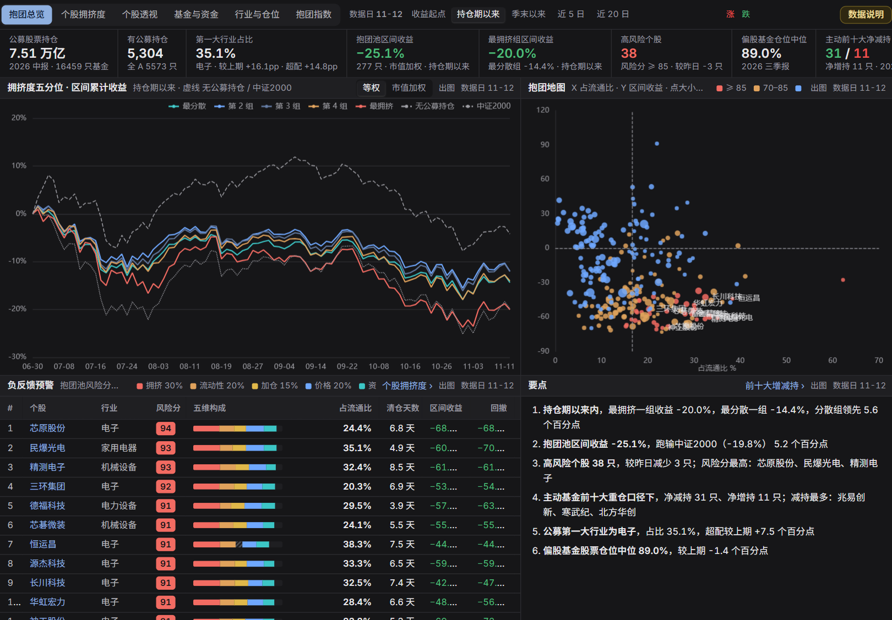</a> 公募抱團</td><td width="50%" valign="top"><a href="images/us-holdings-dark.png">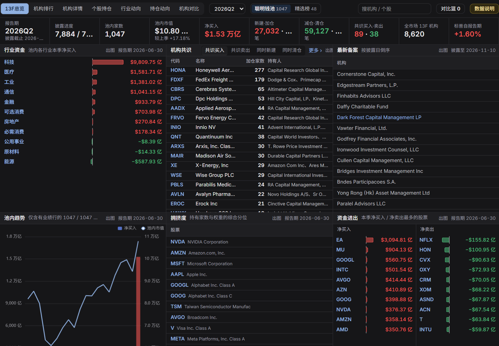</a> 美股機構持倉</td></tr></table>

<table><tr><td width="50%" valign="top"><a href="images/institutional-research-dark.png">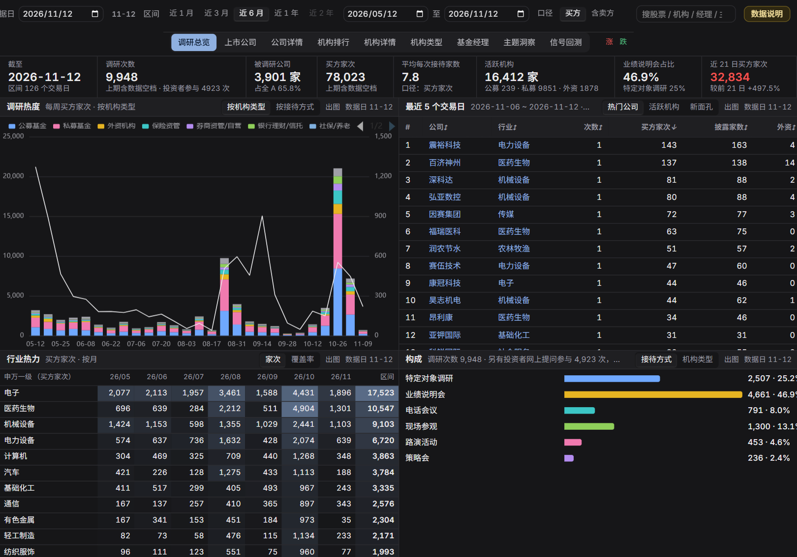</a> 機構調研</td><td width="50%" valign="top"><a href="images/desk-directory-dark.png">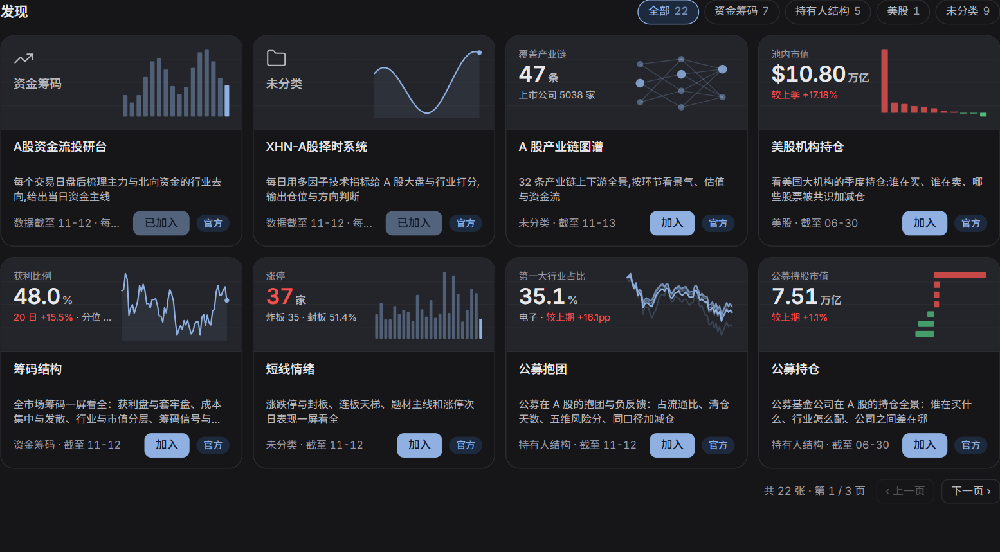</a> 投研台發現目錄</td></tr></table>

## 🧪 AI 策略構建與回測

你可以從自己的交易假設開始，也可以選用官方策略作為起點。兩種方式都可以結合歷史回測，檢查規則在什麼條件下有效，以及為此承擔了多大回撤。

### 自定義策略

你可以把交易想法寫成可檢驗的規則。例如：「回測雙均線擇時策略，以滬深 300 為基準，比較不同引數下的收益和最大回撤。」

在工作空間選擇「策略構建 → 策略回測」輸入需求。也可以先讀已有官方報告，看清策略採用的引數、適用行情和失效場景。

[**開始策略開發 ↗**](https://vicalpha.com/)

| 回測環節 | 要說明或檢查的內容 |
| --- | --- |
| 提出需求 | 標的或樣本池、比較基準、買賣規則，以及希望比較的引數。 |
| 解讀報告 | 把收益與最大回撤、夏普放在一起看，再檢查交易規則和樣本表現分佈。 |

<table><tr><td width="50%" valign="top"><a href="images/ai-backtest.png">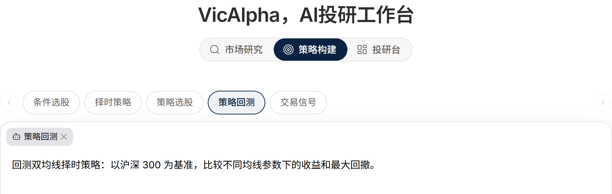</a> 自然語言輸入 · 雙均線需求示例</td><td width="50%" valign="top"><a href="images/strategy-report.png">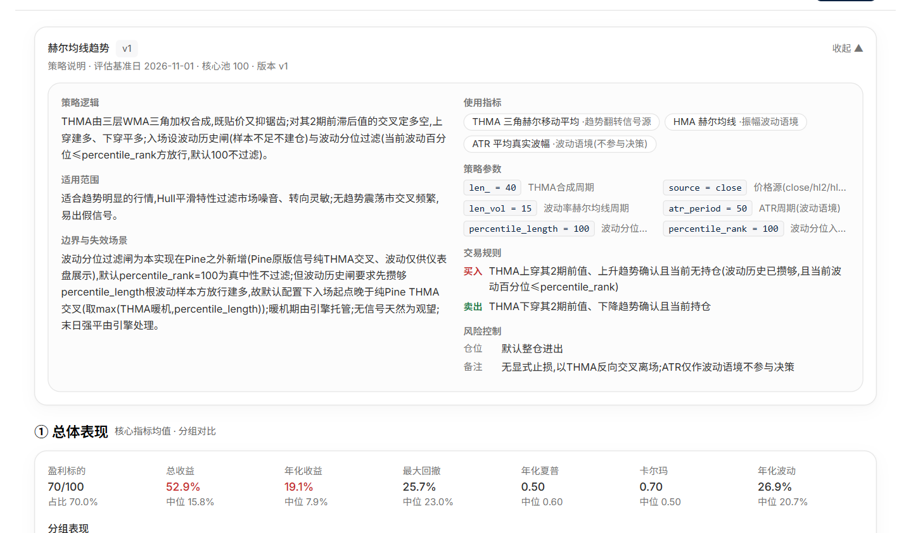</a> 已有官方報告 · 赫爾均線趨勢</td></tr></table>

**歷史會話實景 · 黃金 ETF SuperTrend**

左側為策略開發對話，右側為同一會話中開啟的回測報告。報告覆蓋 **2023-09-08 至 2026-09-07**，**總收益 29.29%**，**最大回撤 30.72%**。

[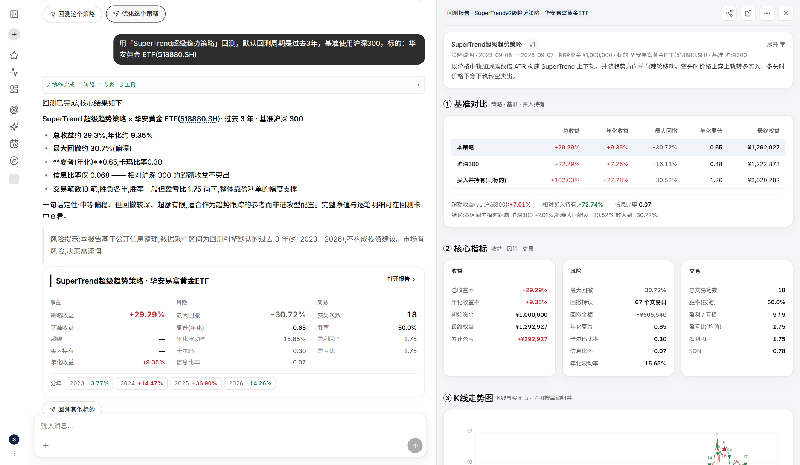](images/gold-etf-session.png)

### 公共策略

你可以從現成策略出發，再用自己的問題檢驗規則。例如：「比較低 PB 和 Piotroski F-Score：兩者怎樣選股，回撤表現有什麼差異？」

截至 2026 年 11 月 13 日，公共策略庫有 **26 個選股策略**和 **30 個擇時策略**。卡片可預覽回測表現分布，開啟報告可查看規則、歷史報酬與回撤，也可複製策略繼續研究。下表列出八個範例。

[**瀏覽公共策略庫 ↗**](https://vicalpha.com/strategies)

[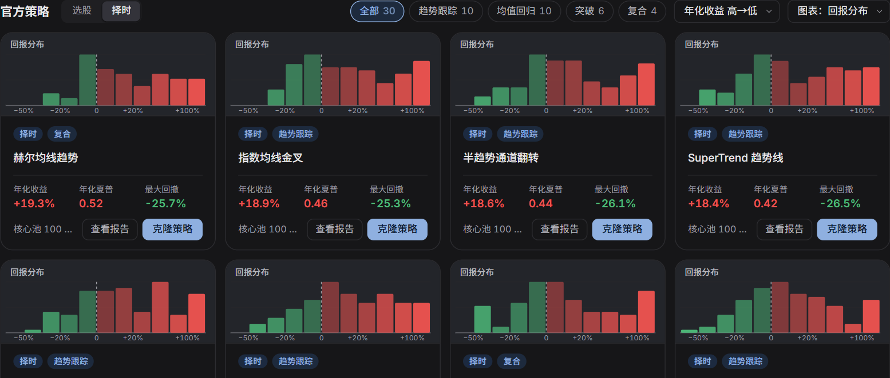](images/strategy-center-dark.png)

| 型別 | 策略 | 規則 | 歷史回測 |
| --- | --- | --- | --- |
| 選股 · 價值 | 低 PB | 按賬面價值相對市值篩選股票。 | [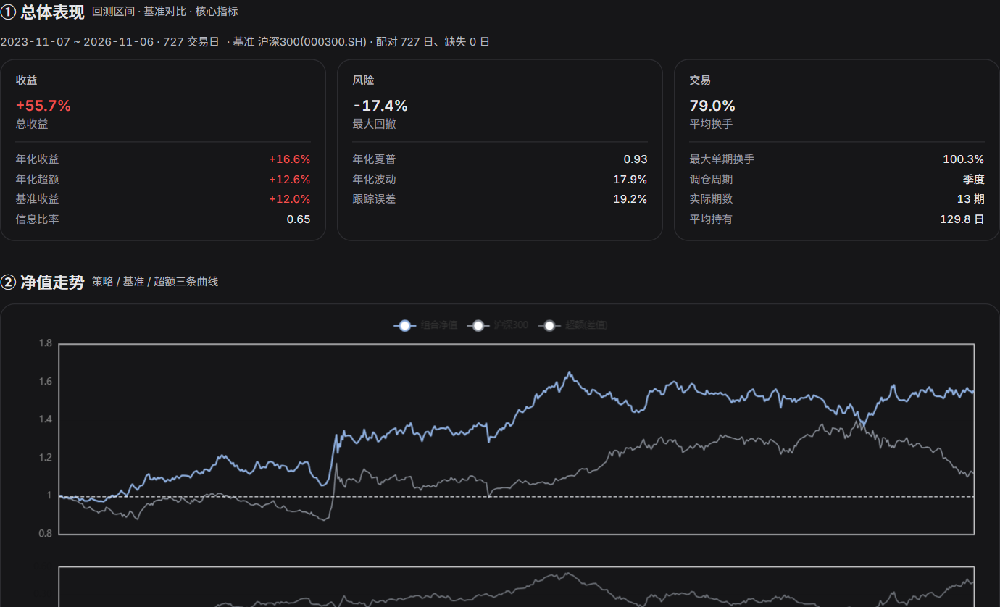](images/report-low-pb-dark.png) |
| 選股 · 質量 | Piotroski F-Score | 用九項財務訊號衡量公司質量。 | [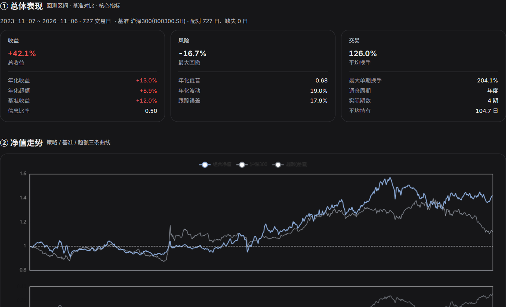](images/report-f-score-dark.png) |
| 選股 · 價值 | 聶夫總回報 | 結合低市盈率、適度增長和分紅篩選公司。 | [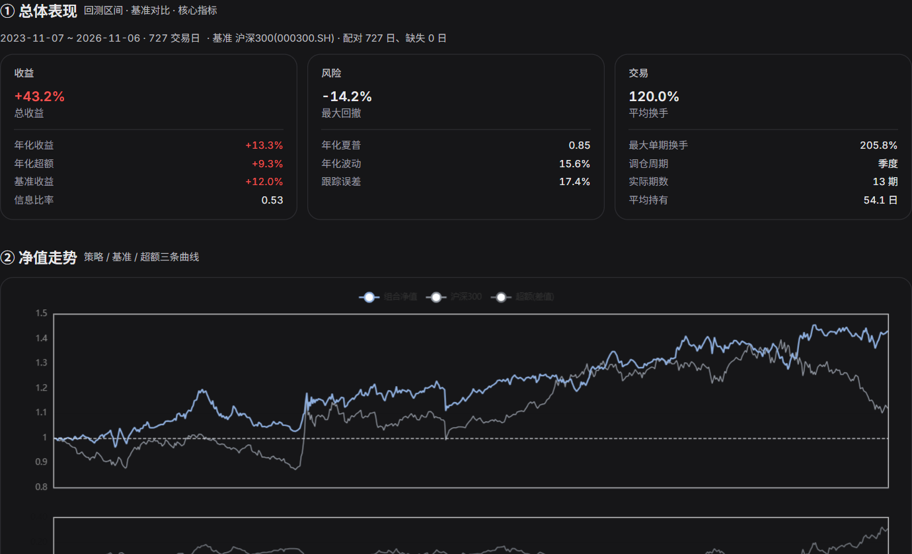](images/report-neff-dark.png) |
| 選股 · 資金流 | 基金持倉增持 | 關注公募持倉佔比連續兩個報告期上升的公司。 | [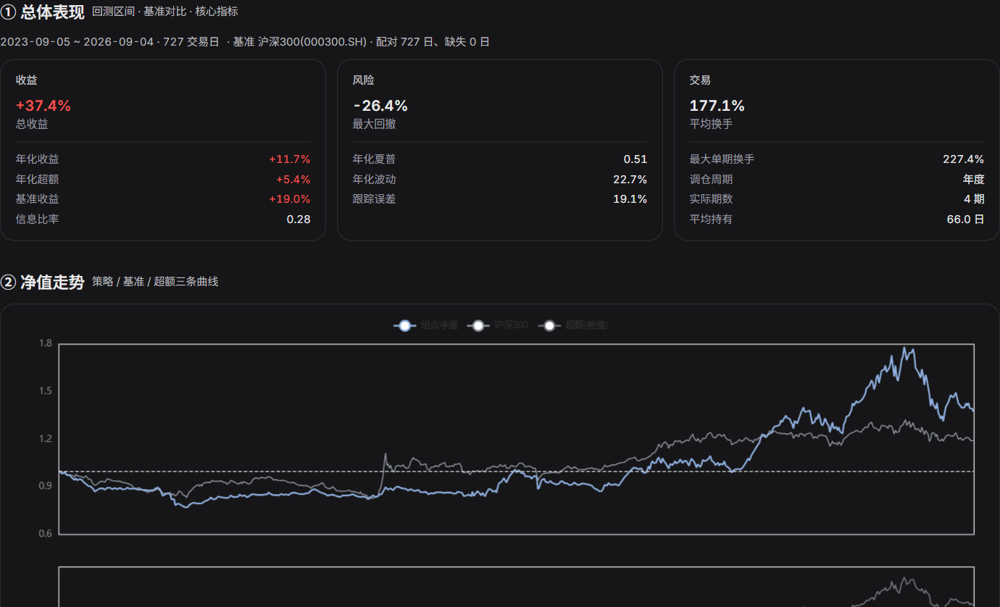](images/report-fund-increase-dark.png) |
| 擇時 · 複合 | 赫爾均線趨勢 | 觀察赫爾均線相對前值的升降。 | [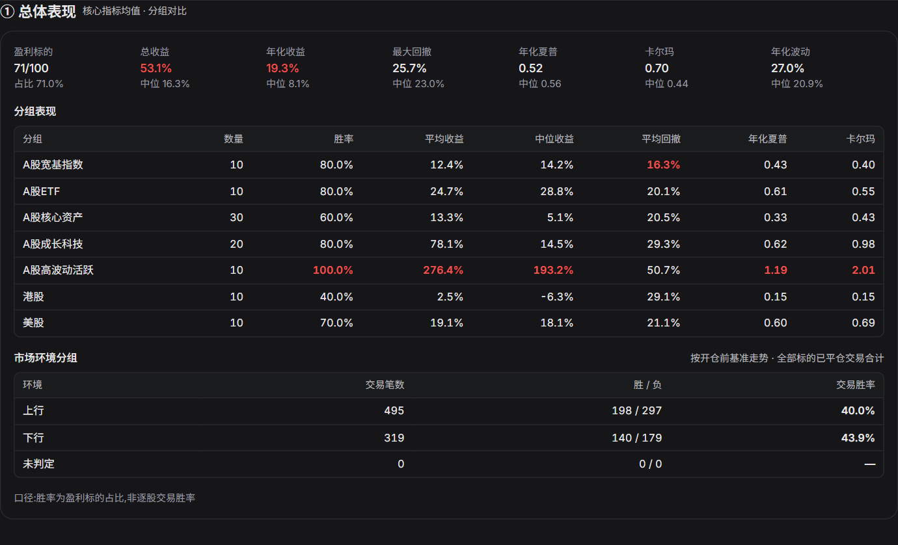](images/report-hull-dark.png) |
| 擇時 · 趨勢跟蹤 | 指數均線金叉 | 以短期與長期指數移動平均線的交叉跟蹤趨勢。 | [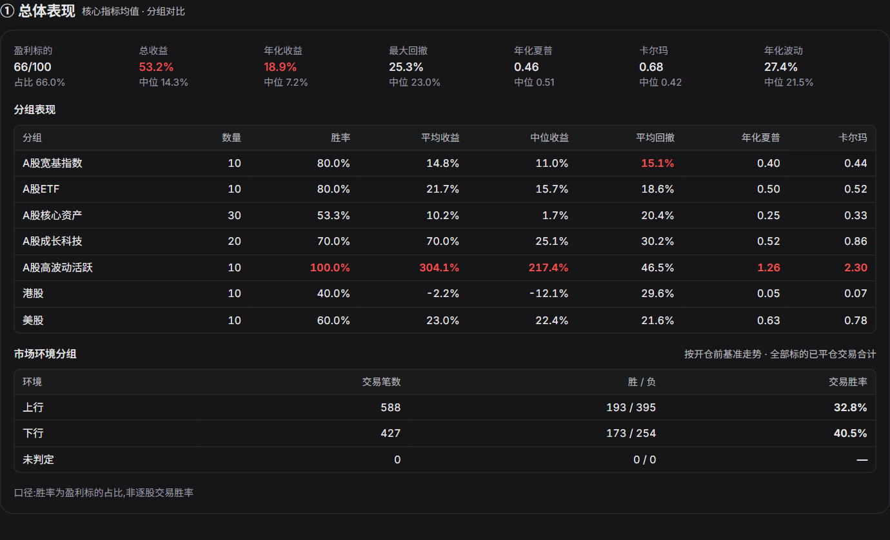](images/report-ema-dark.png) |
| 擇時 · 趨勢跟蹤 | 半趨勢通道翻轉 | 用高低價格的平滑通道識別多空轉換。 | [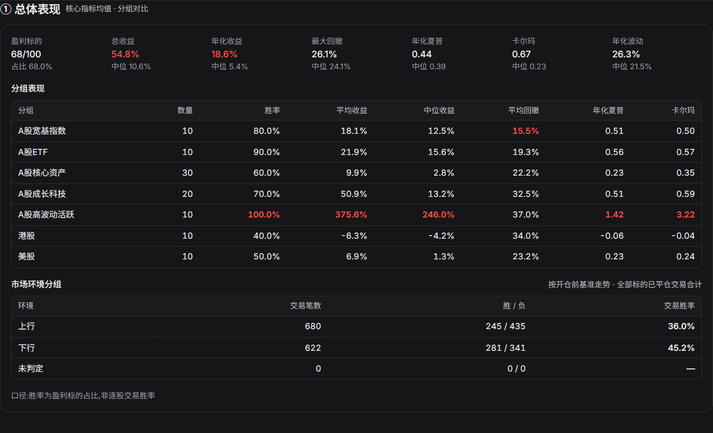](images/report-halftrend-dark.png) |
| 擇時 · 趨勢跟蹤 | SuperTrend 趨勢線 | 觀察價格穿越基於 ATR 的軌道時，趨勢方向是否翻轉。 | [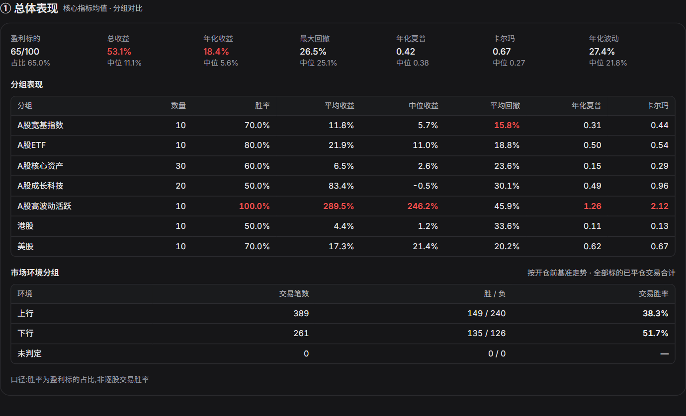](images/report-supertrend-dark.png) |

**歷史回測精選**　按表中四個選股範例、四個擇時範例各自的年化報酬選取低 PB（**16.6%，最大回撤 17.4%**）與赫爾均線趨勢（**19.3%，最大回撤 25.7%**）。前者是組合回測，後者是 100 個標的的平均值。數值來自 2026 年 11 月 13 日查看的歷史回測報告。

## 🔎 個股研究與跟蹤

在個股研究頁，你可以把股價變化與公司基本面對照起來。例如：「過去一年，公司股價相對滬深 300 的變化，是否與主營業務收入和利潤變化一致？」

從概覽進入行情、技術與籌碼、資金、財務、估值、研報與預期、股東、機構持倉或公司事件。下圖以貴州茅臺為例，可直接看到行情摘要、價格對比、公司資料與主營構成。

[**開始個股研究與跟蹤 ↗**](https://vicalpha.com/stock/600519.SH)

新版自選分為 **看盤、總覽、風險與歸因** 三個頁面。進入個股詳情，可查看估值、財務與公司事件。 [開啟自選 ↗](https://vicalpha.com/watchlist)

| 觀察維度 | 可用工具 |
| --- | --- |
| 公司研究 | 財務、估值、研報與預期、股東及機構持倉。 |
| 價格與趨勢 | K 線、均線、布林帶及復權切換。 |
| 量能與動量 | 成交量、MACD、KDJ 和 RSI 等指標。 |

[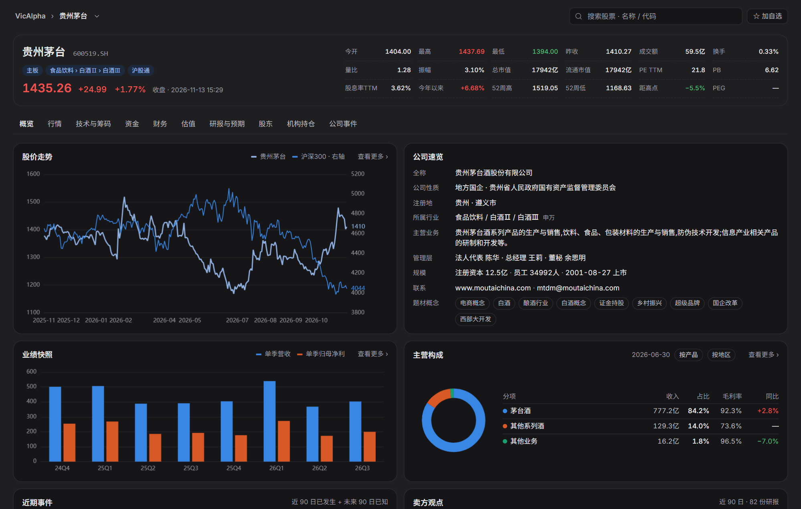](images/stock-page-dark.png)

## 📡 實時訊號提醒

你可以用自然語言定義關注條件。例如：「當自選股滿足我的擇時策略入場條件時提醒我。」平臺持續跟蹤條件，在訊號觸發時提醒你。

在訊號頁，可以從訊號流開始，再用類別、方向和強度縮小範圍；想比較多隻股票時，也可以切換列表或熱力檢視。

[**檢視交易訊號 ↗**](https://vicalpha.com/signal)

| 篩選維度 | 可選範圍 |
| --- | --- |
| 訊號來源 | 策略、技術、形態、量價、資金、事件。 |
| 閱讀方式 | 按方向與強度篩選，按股票合併或逐條檢視。 |

訊號頁支援從自選、寬基指數和產業選擇股票池。可查看當日、5 日、20 日或 60 日內的訊號，並切換訊號流、列表或熱圖。截圖選用滬深 300 股票池。

[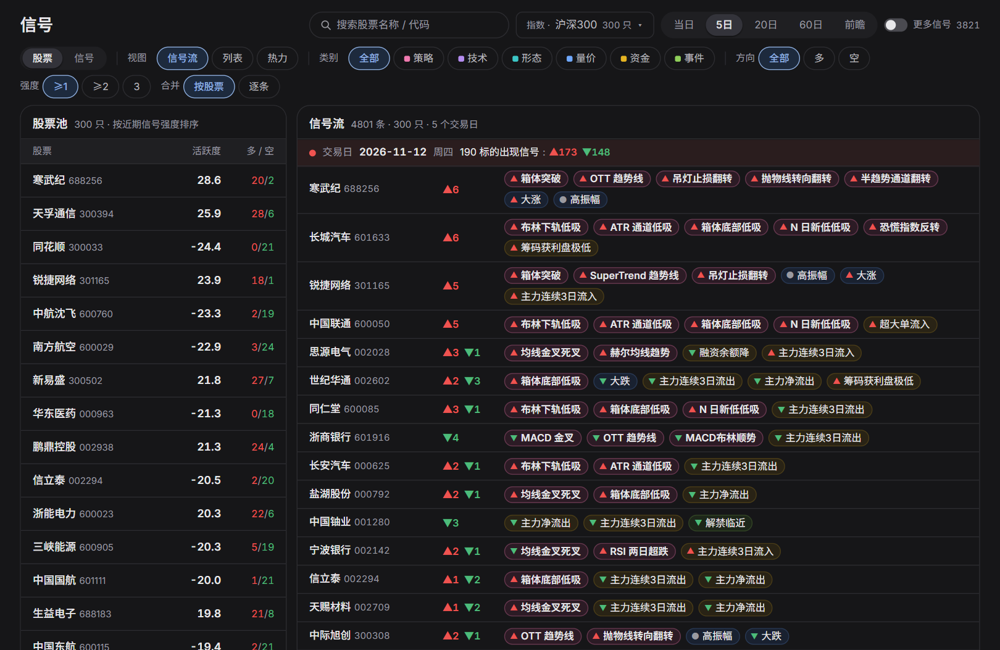](images/signal-page-dark.png)

## 🗓️ 定時研究任務

把重複研究寫成一條帶頻率的指令。例如：「每個交易日收盤後，覆盤 A 股市場廣度、成交額和領漲行業。」

從任務頁點「新建任務」描述需求。已有任務可以按型別、頻率和執行狀態查詢，便於檢查哪些研究仍在跟蹤、哪些需要處理。

[**開始設定你的第一個定時任務 ↗**](https://vicalpha.com/jobs)

| 任務管理 | 可用選項 |
| --- | --- |
| 研究型別 | 報告、選股、回測與策略、簡報等。 |
| 執行頻率 | 單次、每天、每個交易日、每週、每月或自定義。 |
| 執行狀態 | 啟用、已暫停、異常、已停止。 |

[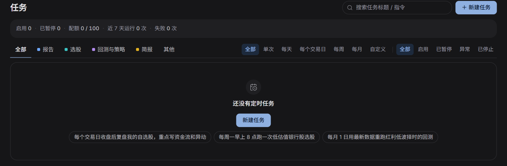](images/jobs-page-dark.png)

[開啟 VicAlpha，開始研究 ↗](https://vicalpha.com/)

## 💬 聯絡方式

開啟 WeChat 掃描 QR Code，即可聯絡 VicAlpha。

